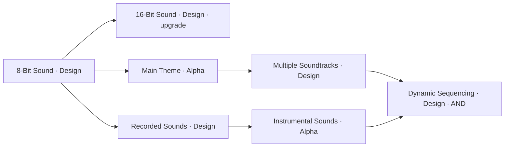

# Audio branch — direct user ruling, 2026-10-28

Status: **LOCKED user-directed graph/phases and IMPLEMENTED locally.** [Source, checks and lag limitation](../logs/2026-10-28-audio-adoption-v1.md). The user additionally retired the entire8-Bit Music→16-Bit Music branch. Numeric content was approved ACTIVE/TRIAL in [trial values v1](audio-feature-values-trial-v1.md). This records the direct instruction in PN Implementation, with subsequent explicit trial-value approval. [Source fence](../findings/audio-branch-20261028-v1/source.json).

## Exact target

| Node | Phase | Ordered acquisition parents | Upgrade relationship | Placement |
| --- | --- | --- | --- | --- |
| 8-Bit Sound | Design | None | Non-upgrade root | Central Audio root |
| 16-Bit Sound | Design | 8-Bit Sound | Upgrades 8-Bit Sound; distinct from 16-Bit Music | Above Main Theme |
| Main Theme | Alpha | 8-Bit Sound | Non-upgrade | Directly right of root |
| Recorded Sounds | Design | 8-Bit Sound | Non-upgrade child | Below Main Theme |
| Multiple Soundtracks | Design | Main Theme | Non-upgrade | Outward from Main Theme |
| Instrumental Sounds | Alpha | Recorded Sounds | Non-upgrade | Outward from Recorded Sounds |
| Dynamic Sequencing | Design | Multiple Soundtracks AND Instrumental Sounds | Non-upgrade | Outward convergence |

Only 16-Bit Sound is an upgrade in this seven-node branch. Explicit upgrade selection must replace lower-tier future-project supply while retaining historical ownership/payment/prerequisite facts and frozen active-project supply. This is the earlier user-directed upgrade meaning, not permission to generalize replacement to non-upgrade children.

Diagram shows prerequisites; the placement column controls the actual common-grid coordinates. Keep the existing compact center and suppress cross-category arrows. All new edges here are same-category.

**Music, Sound Effects, 8-Bit Music and16-Bit Music:** user directs their removal from the active Audio route, explicitly confirming that the entire old music branch is scrapped. Preserve legacy IDs, saved ownership, accepted paid queues, prior receipts and already-begun projects. Removal must be versioned rather than deleting card definitions from old-save validation.

**Supersession:** the earlier suggestions Main Theme→Design, Recorded Sounds→Alpha and Dynamic Sequencing→Alpha in Proposal028/Handoff023 are superseded by this exact user ruling. Multiple Soundtracks remains Design and Instrumental Sounds remains Alpha. A Design child may be researched after acquiring an Alpha parent and played in a later project's Design phase; acquisition progression need not follow one project's phase order. Do not change the phases to enforce a same-project order.

## Intake source facts (before adoption)

- At intake the six Audio IDs were Music, Sound Effects, 8-Bit Sound, 8-Bit Music, Recorded Sounds and 16-Bit Music. The five new cards were absent at intake and are now implemented.
- Existing 8-Bit Sound: Sound5/Scope2, Design, finite. Recorded Sounds: Sound5/Scope2, Design, finite, base price$1,700, current later-play fee unspecified. Preserve these existing values unless a new numeric ruling changes them.
- User explicitly retired8-Bit Music→16-Bit Music in the follow-up answer. Preserve both IDs historically; new16-Bit Sound is distinct and must not be implemented by renaming16-Bit Music.
- StudioSpecialties v4 gives Sound Effects to all eight genre pools and Music to Sports. Every new pool must still total12 Scope. Replacing Scope1 Sound Effects with Scope2 8-Bit Sound changes that total; a new root-connected roster version is required, while historical v1–v4 membership remains exact. Do not silently rewrite current saves or grant both tiers.
- ProjectState freezes supply at Begin through PrimitivePredevelopment. Upgrade/retirement filtering belongs at future-project supply selection; it must not mutate that active array or finance/history/RNG.

## Numeric selection and bounded adoption

For 16-Bit Sound, Main Theme, Multiple Soundtracks, Instrumental Sounds and Dynamic Sequencing, the exact ordered Core/Scope/base price, $0 direct play fee and starting-era availability were approved by the user and are implemented in [trial values v1](audio-feature-values-trial-v1.md). Their department and finite lifecycle should follow current Audio Feature conventions, with Alpha department `audio`; implementation details cannot silently choose their numerical balance. No existing authored table supplies these exact five definitions.

The user answered both clarification questions: scrap the old music branch and propose trial values for review. [Trial values v1](audio-feature-values-trial-v1.md) now supplies five candidate numeric rows, with explicit availability and remaining migration boundaries. The graph/phase/retirement ruling itself needs no renewed approval; the user subsequently selected the trial values and they are adopted locally.

## Bounded adoption and verification contract (executed; see log)

1. Seal current source and real predecessor world/Studio saves. Preserve inherited edits and `.codex-godot-temp`.
2. User selection of the five numeric rows and trial availability is recorded; the source-pinned implementation plan was executed. The old Music subbranch is explicitly retired. Keep unrelated Handoff023 Gameplay/Visuals/Alpha-ancestor-gate work outside this Audio change.
3. First add failing tests for the exact root/parents/phases, AND requirement, new16-Bit Sound identity, explicit upgrade metadata, retirement and12-Scope founder rosters. Existing saved projects keep exact old supply and card behavior.
4. Add versioned new-card definitions, active-catalog filtering and explicit future-project replacement selection. Introduce a new founder-roster version, preserving old versions and financial history. Reconcile exact predecessor content/source pairs for player and rivals; reject unknown/mixed pairs.
5. Update only Audio map cells to keep root centralized, 16-Bit Sound above Main Theme, Recorded Sounds below it, and the two-parent convergence readable. Purchase details name upgrade/replacement effects; all missing parents remain navigable.
6. Verify legal research/purchase/installment/familiarity and rejected-action atomicity; future supply filtering; cross-project Design/Alpha play and finite exhaustion; live/headless state/actions/RNG parity; exact old-save player/rival/history/finance/RNG restore and Studio-only Continue. Run focused map/navigation/native captures after headless checks. Record actual PASS/FAIL/NOT RUN; do not call a content table gameplay-ready before implementation checks.

## Verification at this record

Audio implementation and focused runtime/native/replay/migration checks pass as documented in the implementation log. Performance acceptance FAIL/OPEN: matched cycle192 Research526ms before→594ms final against unchanged500ms limit; background durability also remains open. No player-save modification, commit/push/export or no-lag claim; scheduled automatic checks remain disabled.
