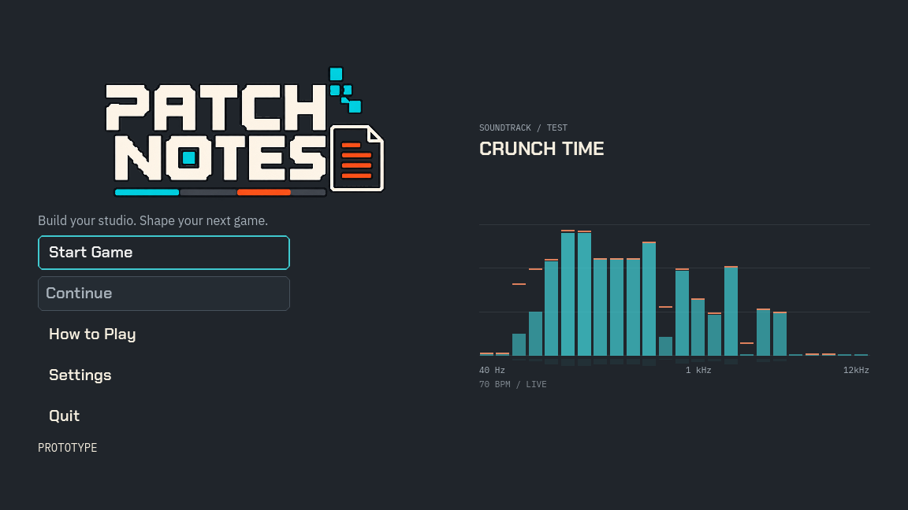

# Main-menu spectrum prototype — 2026-10-27

User asked for a test audio visualizer fitting the main-menu layout. Read current state/queue/README, UI design and source/diff; inspected dirty `main`, HEAD `087df09d653858b72c6e2dc344352237433dd3ac`. Existing shared edits and `.codex-godot-temp` preserved. Built inline using the existing Godot/Theme/menu architecture, with scoped independent read-only code review.

## Changes

- New `scripts/ui/menu_audio_visualizer.gd`:24 log-spaced40–12,000Hz bands sampled from the actual Music-bus spectrum. FFT1024,0.1s buffer,35ms attack/180ms release,150ms peak hold and bounded decay. Cyan fills, orange peaks, faint grid/reflection and existing Theme fonts; no opaque panel. The1kHz tick uses the same logarithmic mapping. Footer identifies70BPM/live or quiet, small test caption marks prototype status.
- `scripts/phases/main_menu.gd`: place the decoration in the unused right gutter, centered within that region, max560×340. Existing title/buttons stay in place. Show only at root navigation, when visible, not transitioning, with at least120px gutter/360px viewport height. Root folders hide/release spectrum work; Back recreates one analyzer. Decoration ignores pointer/focus, so existing controls remain authoritative.
- Analyzer owns only its transparent effect resource. Detach only that exact resource from any bus on hide/teardown; pause reverb, Music/Master volume/mute and existing player stay intact. Music/Master gain/mute and stopped transport silence the visual response. No soundtrack seek/play/pause calls, other-bus analysis, fake/random beat pulses or gameplay RNG.
- `scripts/market/rival_world_checkpoint.gd`: exact preceding source `6e31125897228a4a80f175f449f0fdd52400079450a310b4ee6f40a71d063d4a` allowed under ordinary field validation. No saved-field or gameplay change.
- New maintained verifier `scripts/debug/verify_menu_visualizer.gd`; UI design/current/TODO updated. No new audio asset, external upload, commit/push or EXE/ZIP.

API verified against official [AudioEffectSpectrumAnalyzer](https://docs.godotengine.org/en/stable/classes/class_audioeffectspectrumanalyzer.html) and [instance](https://docs.godotengine.org/en/stable/classes/class_audioeffectspectrumanalyzerinstance.html) docs. The analyzer performs read-only frequency analysis without altering audio; the returned vector contains linear left/right magnitudes. FFT1024 is the documented latency/stability compromise. No sample-perfect audible-device/FFT phase-alignment claim: this is a smoothed live spectrum, independent of card presentation timing.

## Evidence and verification

Finding: `docs/codex/findings/menu-visualizer-20261027-v1/`. Before files, real preceding Studio/world, exact command/exit/error receipts, native frames, source manifest/audit and scoped patch retained. No whole-project snapshots created.

Runner: bundled Python `-X utf8 .../run.py LABEL SCRIPT [--native] [--device] [--out=ABSOLUTE_DIRECTORY]`, Godot4.7.1, private profiles/writer ports. Default audio Dummy; `--device` uses WASAPI. Player saves untouched.

| Label / coverage | Result |
|---|---|
| baseline / prior restore.gd `--capture` | PASS2, genuine preceding Studio/world |
| red / verify_menu_visualizer | Expected failure: title has no visualizer |
| green | Test-helper error: PackedFloat32Array has no max method;130s runner timeout retained. Replaced with explicit maximum helper and bounded verifier timeout; no runtime fix claimed |
| headless-final / same | PASS116, actual soundtrack energy peak0.642658; layout at1152×648,1280×720,900×600,1920×1080 and compact720×600 omission; all bar bounds, no input/focus; Music/Master mute/volume; setup/other folder/Back; player identity/time, effect cleanup |
| native-final / same, real WASAPI | PASS119, actual FFT peak0.395570; all above plus3 successful PNG saves. Native images inspected |
| native / earlier Dummy render | PASS119;3 earlier captures retained. Final set corrects the1kHz label's log position |
| folder-navigation | PASS89 actual folder actions/pointer/focus/drafts/teardown |
| settings | PASS29 display/audio/preferences/focus/action checks |
| settings-motion | PASS14 actual title forward/back trajectories and input-lock release |
| sync | PASS3,503 continuous music grid/sequence/loop/pause checks |
| cold-verified | PASS10 exact preceding player/world/RNG/save bytes, no replacement generation, unknown source rejection |
| identity-final / Python audit.py | PASS actual non-debug resource bytes and exact predecessor reconstruction, including exclusion of newly added observer from old manifest |

One guessed obsolete verifier filename (`verify_ui_design_system.gd`) was absent; failed invocation retained, then the actual maintained `verify_ui_folder_navigation.gd` was found and passed. Successful receipts have no SCRIPT ERROR/ERROR/FAIL; existing ObjectDB cleanup warnings remain. Scoped independent review found no actionable issues, including resource teardown, bus gain/mute, navigation/input/layout and predecessor gate.

Final runtime identity `3b2a7b9b837a714768da133f90d6ce893fd9385bebd4ad2795b3acc10e9ad760`. No gameplay/performance whole-campaign acceptance or subjective visual/audible approval claimed. Future styling is a prototype/playtest choice. Existing release packages unchanged.

## Preview

