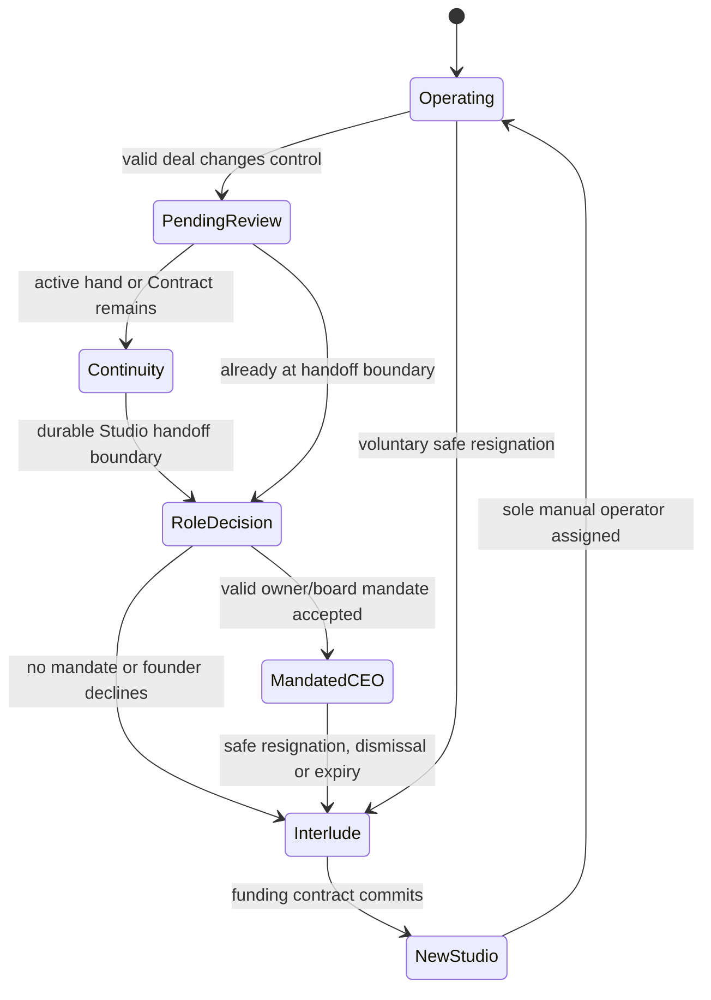

# Founder role and post-control transition — selected design v1

**Date:** 2026-10-11 (America/Los_Angeles). **Authority:** the user's delegation to select the next Founder Legacy architecture after the [share-sales/control ruling](2026-10-11-share-sales-and-control-v2.md). **Status:** SELECTED DESIGN, unimplemented. This details [SPEC-v2 §8](SPEC-v2.md#8-founder-transition-ceo-and-subsidiaries); numerical terms remain CANDIDATE/OPEN. No canonical gameplay or shared TODO change follows.

## 1. Two boundaries, one operator

An ownership deal commits at a **transaction boundary**: after a legal world action has fully resolved, or at the corporate-quarter settlement point. Shares, buyer/seller consideration and direct voting controller change together. A transaction boundary can occur while the player has an unfinished development phase or Contract; it is not a durable Studio Continue checkpoint.

Manual operator reassignment occurs only at an **operator handoff boundary**: a quiescent Studio point already eligible for a durable checkpoint, such as the return after a release or completed Contract dismissal. A takeover during an active phase records `pending_role_review` and grants a narrow continuity permit for the founder to complete the current legal work. It does not authorize new shares, borrowing, acquisitions, subsidiary policy or a second manual team. The world and old Studio continue paying their actual obligations. The takeover is legally effective immediately; the temporary permit only delays the controller's replacement of the manual operator.

At the handoff boundary, compute the new founder role and AI operator assignment, then atomically persist a whole-world checkpoint containing that result before publishing it. If checkpoint writing fails, preserve the current legal Studio session and keep the role transition pending under the existing save-failure policy. No menu navigation or offer preview advances time or creates another checkpoint. The implementation must demonstrate a legal path out of every supported active hand/Contract, including an unaffordable or blocked continuation; it may not silently discard that work to make migration possible.

## 2. Authority to grant a CEO mandate

If one direct holder has more than 50% of votes, that holder may offer, renew or revoke the founder's CEO mandate. Corporate parent votes are cast through the existing acyclic control chain. If no holder has a direct majority, a specific mandate decision needs affirmative votes representing more than 50% of issued units. A tied/failed vote grants no mandate; a coalition approving one mandate does not become a permanent controller. Pooled passive investors use a deterministic governance policy, not individually simulated retail votes.

A mandate is a signed, versioned role agreement tied to the Studio, founder and current governance authority. It records permitted operating actions, start cycle, review/expiry condition, issuer/vote identity and status. Takeover mandates may continue until a disclosed review condition, resignation, dismissal, expiry or controller replacement; they do not pop up for renewal every quarter by default. A backstop-financed new Studio has an explicitly time-limited mandate already shown in its formation quote. The exact term and any renewal economics require calibration.

When control changes again, the new controller reviews the existing mandate at the next operator handoff boundary. The continuity permit applies until then. The new owner may renew or replace the mandate; silence or failed approval ends it at that boundary. Any signed exit/mandate term in an accepted acquisition offer is honored as part of that deal and displayed before the founder accepts.

## 3. What the founder can do

| Role | Manual seven-card and ordinary Studio actions | Corporate decisions |
|---|---|---|
| Founder controls and operates the Studio | One manual team; legal Store, development, publisher Contracts, hiring, campaigns and existing Bank actions | May exercise its majority votes for equity, financing, acquisitions and subsidiary policy, subject to the same transaction validator as AI companies. |
| Founder is minority CEO under mandate | The same one manual development team and ordinary legal operating actions using this Studio's funds. Existing rent, payroll, debt service and Contracts continue. | New equity, new borrowing, voluntary debt restructuring/payoff, M&A and parent policy need owner/board authorization. The founder may request a decision; a request is not approval or cash. |
| Founder is in Interlude or operates another Studio | No manual actions for the former Studio; its AI session continues. Founder may review career history and their own live share offers. | Voting rights from retained shares remain, but no operating commands or transfer of Studio resources. |

Ordinary publisher Contract advances remain part of the existing legal development route under a CEO mandate; their debt/obligation effects stay with the Studio. The mandate never changes card legality, Feature ownership or the source of development outcomes. Owner policy is high-level and cannot pick cards for the founder. Optional Bank actions reserved to the owner must have a visible governance-request path when the player is CEO; the actual loan or payoff occurs only after owner approval and the normal Bank/finance validator.

## 4. Offer, loss, exit and new venture

1. **Before commitment:** show offered shares, valuation anchor, exact payment, resulting cap table and whether founder majority or CEO authority changes. The player explicitly accepts any sale of their shares. A negotiated-exit package can atomically record a sale and a later safe-boundary resignation term; a sale alone does not imply resignation, and resignation alone does not sell shares.
2. **After commitment:** recalculate direct majority. If the founder still controls, ordinary operation continues. If the founder becomes an exact-50% or minority holder, record the reason (`founder_sale`, `approved_issuance` or other valid transaction) and either an agreed mandate or a pending role review. Another shareholder's secondary sale cannot remove an existing founder majority.
3. **At handoff:** present the documented CEO mandate if valid. The founder can accept it, decline it, or resign. A failed/no-majority board decision grants no mandate. If the founder leaves, the old Studio keeps all money, debt, IP, employees, Features, Fans, subsidiaries, pending research, releases and Contracts and becomes AI-operated from its exact committed state.
4. **Career continuation:** the founder enters a checkpointable Founder Interlude or atomically activates an already funded replacement Studio. New-Studio cash comes only from its accepted loan/equity package. Share-sale proceeds remain an external settlement record, never a founder wallet or transferable startup grant. Interlude `seek_backing` is a purposeful world-cycle action under the existing design, not a free calendar skip.
5. **Later return:** a founder who retains majority or receives a fresh mandate may return to a former Studio only after both the current and target operator sessions reach handoff boundaries. The current team becomes AI-run before the former Studio becomes the sole manual team. No old cash, IP, staff or project state follows the founder between Studios.

## 5. Edge cases and acceptance obligations

- **No majority owner:** exact 50% does not preserve founder control. A specific >50% governance vote can still appoint a CEO. If that vote fails, the former Studio becomes AI-operated at handoff; the founder retains shares and can pursue new financing.
- **Two control changes before handoff:** process committed transactions in order, keep one continuity permit, and let the latest valid governance authority decide the lasting role. Revalidate any earlier signed mandate/exit terms; never run two operator transfers or duplicate a share payment.
- **Mandate expires mid-phase:** mark it pending; complete the legal work under the narrow continuity permit, then apply expiry at a handoff boundary. The saved world includes expiry, permit and pending review IDs.
- **Failed save, stale offer or failed funding:** change no operator on an invalid transaction or failed checkpoint. Do not create a free new Studio to escape debt or an unfinished Contract.
- **CEO requests Bank action:** a request cannot reserve or spend the target's cash, bypass ordinary Bank eligibility, or create a loan. Owner approval and a fresh exact Bank quote precede the ordinary financial transaction.
- **Reputation and milestones:** preserve once-only founder career achievements. Record whether departure was voluntary, mandate declined, dismissed or negotiated; any reputation/underwriting effects use explicit later-calibrated policy. Acquisition alone carries no automatic cash or generic reputation penalty.

The implementation handoff must test these role states at fresh-process world Continue and rollback boundaries, including an active Contract, exact-50% board vote, controller change, rejected mandate, backstop mandate expiry, no duplicate operator and old-Studio AI continuation. The source-specific recovery path for an active phase with no affordable legal continuation needs a focused audit before implementation; this document does not authorize inventing a mid-phase cancel or changing current checkpoint rules.
