# Founder Legacy: five possible victory conditions

**Date:** 2026-10-17 (America/Los_Angeles). **Status:** USER-DIRECTED victory routes; proposed measurement and attribution architecture. Routes 1–4 express the user's requested possibilities, with their unspecified values **OPEN**. Route 5 is explicitly **PROVISIONAL**. This is a design record, not a gameplay implementation or balance approval. It extends [SPEC-v2](SPEC-v2.md) and its endless-continuation rule without changing the seven-card game or the canonical source.

## Shared victory contract

The five routes are alternatives: completing **any one** grants its own once-only Founder Legacy victory. Other routes remain available. A victory is a persistent founder milestone, not a forced campaign ending. Show the evidence, offer **Continue**, and keep the world, Studios, shares, debts, AI activity and calendar intact. Later loss of Fans, subsidiaries or control cannot revoke an earned milestone; the live progress display can still fall or reset.

Only committed, validated world events can advance victory progress. Offer previews, queued Research, unsaved hands, forecast sales, archived pre-1980 titles and UI navigation cannot. The world checkpoint should carry a versioned victory ledger with evidence IDs, annual results and claim IDs. `FounderProfile.milestone_ids` remains the once-only founder achievement list; a world validator must reconcile each victory claim with that list. Do not add a personal wallet or copy Studio-owned Fans, Features or IP into the founder profile.

| Route | Win trigger | Current source/dependency | Status |
|---|---|---|---|
| 1. Five Game of the Year awards + Fans | Founder is credited with the global award in five consecutive eligible release years and the **currently operated Studio** has at least `X` Fans at a committed boundary. | Released title Review/year and Studio Fans exist; global annual award adjudication does not. | Route requested; `X` OPEN. |
| 2. Ten subsidiaries | Founder ultimately controls **10 distinct subsidiary Studios** through valid majority-controlled corporate chains at one committed ownership boundary. | Equal-share books and acyclic control exist; group traversal/qualification display remains to build. | Route requested; count 10 supplied by user. |
| 3. Market influence for five years | Founder-controlled corporate group reaches at least `Y%` annual influence in **five consecutive complete eligible calendar years**. | Real title sales exist; an industry-wide influence denominator and sufficient market population do not. | Route requested; `Y` and market coverage OPEN. |
| 4. Feature Store technology | One founder-operated Studio completes an authored, versioned **Innovation Path** through Store prerequisites and its final research capstone. | Store ownership/research and validated prerequisite graph exist; victory path/capstone content does not. | Route requested; path/content OPEN. |
| 5. Original Studio comeback | Founder genuinely loses effective control of the original Studio, a later founder-controlled Studio buys majority control back, and the original Studio earns **three consecutive** Game of the Year awards from post-reacquisition releases. | Shares and safe operator handoff exist; original-Studio/control-episode and award records do not. | PROVISIONAL; exact agency rule open. |

## 1. Game of the Year and Fans

Introduce one global, deterministic Game of the Year result for each eligible calendar release year. The award considers actual post-start releases from every Studio; pre-1980 frozen history is ineligible. A title's `release_year`, `release_cycle`, Studio/release ID and frozen Review come from the committed release record. **Proposed award ranking:** highest frozen Review; ties use that title's first completed sales-month units, then stable release ID. Adjudicate year `y` after January of `y+1` closes so a December release has one complete sales month. If required facts are absent, the award remains pending rather than inventing a winner. The ranking/tie contract needs its own design review before gameplay adoption.

Credit a founder only if they manually operated the winning title's Studio at its legal launch. A later sale or migration does not rewrite that authorship. AI subsidiaries can win for their Studios but do not generate a founder's personal award streak. There is at most one credited award per year; a no-release year or a winner not credited to the founder breaks the streak. Count five **consecutive award years**, even if the founder operated different Studios across those years. After the fifth credited award, check the Fans of the currently operated Studio at committed boundaries until the next annual result either continues or breaks the streak. The `X`-Fan value stays open; Fans remain Studio-owned and are never summed into a personal balance.

## 2. Ten subsidiaries

At a committed share transaction, traverse the acyclic ownership graph. A Studio is a qualifying subsidiary when a Studio ultimately controlled by the founder holds a chain of **more than 50% direct voting control** down to it. Count unique legal Studio IDs once, exclude the controlling root Studios themselves, and do not count a passive stake, an offer, an exact-50% tie, or a second manual team. Multiple founder-controlled roots may contribute distinct subsidiaries; duplicates across paths count once. An acquired former player Studio can qualify and continues autonomous AI development. Claim the milestone when the count first reaches 10; subsequent sales reduce live count without deleting the achievement. No shell company may be created for this counter outside the same funded Studio-formation rules used by every company.

## 3. Five years of market influence

**Recommended structural metric:** annual **unit-sales share**, because it measures audience reach without mixing Fans, cash, Review and arbitrary weights. For eligible year `y`, let `U_group(y)` be actual earned external title units accrued during cycles when their Studio belonged to a founder-controlled corporate group, and let `U_industry(y)` be the same units for the full eligible industry. Then `influence_bp(y) = floor(10,000 × U_group(y) / U_industry(y))`. Use checked integer arithmetic and count each Studio/title once. Acquiring a seller in December cannot claim that Studio's earlier-year units. Minority CEO operation without majority corporate control does not confer group influence. A zero or incomplete industry denominator is **unscorable**, never 0% or a free qualifying year.

Freeze one year-end snapshot with all source cycle/release IDs, group-control intervals, numerator, denominator, formula version and eligibility. Five consecutive complete years with `influence_bp >= Y_bp` grant the victory; an ineligible year or below-threshold year breaks the active streak. `Y_bp` is OPEN. The current two-rival trial is too small to stand for the whole industry, so this victory must remain **inactive** until an approved industry roster/market denominator and save-compatible annual ledger exist. The AI market-pressure thread owns the underlying market population and sales-index authority; this victory consumes its committed records rather than defining rival strength.

## 4. Store technology victory

Do not define this as “own every Store node”: the catalog can grow by era and branch, and acquisitions must not silently transfer IP between Studios. Author a separately versioned **Innovation Path** over existing Store prerequisite IDs, spanning multiple technology branches and ending in a new capstone Research completion. The path definition is pinned when activated for a campaign, so later catalog additions do not move an existing save's finish line. Entry, installment and completion follow the ordinary paid Store Research rules; queue admission alone is not progress. The active founder-operated Studio must legally own the required nodes and complete the final capstone itself. Buying an already-complete research Studio does not award an immediate victory, and leaving a Studio does not move its Features to the next venture. The exact branch nodes, era gates, capstone name/cost/duration and any presentation are OPEN content decisions. No capstone is available from today's live Store ledger.

## 5. Original-Studio comeback (provisional)

Record an immutable `original_studio_id` at founder creation. A loss episode begins only when a committed share transaction removes the founder's ultimate majority control of that Studio; resignation alone, a hostile offer or an exact-50% claim without an actual transaction does not qualify. The Studio must spend at least one committed world cycle outside founder control and under its own AI state. Buyback requires a **paid** corporate acquisition by a founder-controlled Studio resulting in renewed more-than-50% control of the original Studio. The buyer uses its own Studio cash/finance; founder sale proceeds never become a personal bankroll.

After that reacquisition, the **original Studio itself** must produce winners in three consecutive eligible award years, with each qualifying title launched after buyback and the Studio continuously inside the founder-controlled group until the third award. A fresh loss resets this comeback attempt; a later paid reacquisition can start another. This prevents a pre-buyback award, an instant sale/repurchase loop or another subsidiary's hit from completing the story. Whether the founder must personally return to operate the original Studio for those releases is **OPEN**; the recommended first version allows its legal AI team to win while under founder corporate control, because parent control does not automatically grant a second manual team or a CEO mandate. This entire route remains provisional at the user's request.

## State, timing and compatibility

```mermaid
stateDiagram-v2
    [*] --> Tracking
    Tracking --> AnnualClose: completed world year
    AnnualClose --> Tracking: freeze award and influence records
    Tracking --> Evaluate: committed sale, Research, Fans or annual result
    Evaluate --> Tracking: no route complete
    Evaluate --> Claimed: first fully evidenced route completion
    Claimed --> Tracking: show Continue; keep world active
```

Store `victory_rules_version`, activation cycle/first eligible year, original Studio ID, annual award results, annual influence snapshots, control-loss/reacquisition episodes, Innovation Path identity, and once-only claims inside the **world** checkpoint. Claims reference immutable release, finance/ownership and research event IDs. Event order is deterministic: finish the productive world cycle and all Studio settlements; freeze any due annual record; evaluate victories; atomically save the world; then display a victory notification. A save failure cannot publish a claim absent from the durable world. If multiple routes complete together, commit distinct claims in stable route-ID order and show both.

For old Studio-only or earlier world saves, preserve their original bytes and existing compatibility rules. Do not retroactively invent GOTY or influence years from incomplete history. New games can track from their first year; an upgraded midyear save begins annual eligibility with its next complete year unless the full source history is provably available. Previously owned Features may satisfy prerequisite ownership after validation, but the Innovation capstone itself must be completed after activation. Victory progress can show “not yet measurable” for missing systems rather than an invented zero.

## Implementation sequence and checks

1. Add a versioned world victory ledger and founder milestone claim reconciliation, without enabling any route that lacks evidence. Add a read-only progress view and endless Continue contract.
2. Add annual GOTY adjudication from real release records and first-month units, with cold Continue, year-boundary/tie/no-release tests. Then enable route 1 once `X` is chosen.
3. Add transaction-boundary subsidiary traversal and route 2, testing 50%, indirect control, duplicates, sale/rollback and former-Studio AI continuation.
4. Integrate the market's full annual sales index and control intervals. Enable route 3 only after denominator coverage and `Y` are approved; test acquisition timing, zero market, five-year streak and seeded replay.
5. Author the Innovation Path/capstone using Store research and version its content; test payments, ownership, migration, catalog revision and route 4.
6. Add original-Studio loss/reacquisition episodes and route 5 only after its provisional agency rule is confirmed; test paid buyback, continuous control, three post-buyback awards and repeated loss.

Award adjudication is annual; subsidiary and research checks are event-driven; influence sums can accumulate once per world sales cycle and freeze yearly. No per-card global victory scan is needed. Save only bounded annual summaries plus referenced source IDs; historical claims remain append-only. Deterministic seeded tests must prove rejected transactions, previews and rollbacks change no victory progress, and a claimed milestone fires once after cold Continue.

## OPEN for the user or owning designs

- Route 1: `X` Fans, award ranking/tie presentation, and whether the Fans threshold may be reached after the fifth award but before a streak-breaking annual result.
- Route 3: `Y%` and approval of unit-sales share as the displayed meaning of “market influence”; complete industry population/denominator authority is an AI market dependency.
- Route 4: exact Innovation Path nodes, eras, capstone and whether any final release demonstration should follow capstone Research.
- Route 5: whether the original Studio's legal AI wins count or the founder must return as its sole manual operator; the route itself may change.
- Victory presentation: wording and any optional rewards. No cash, shares or IP should be granted merely for a victory.
