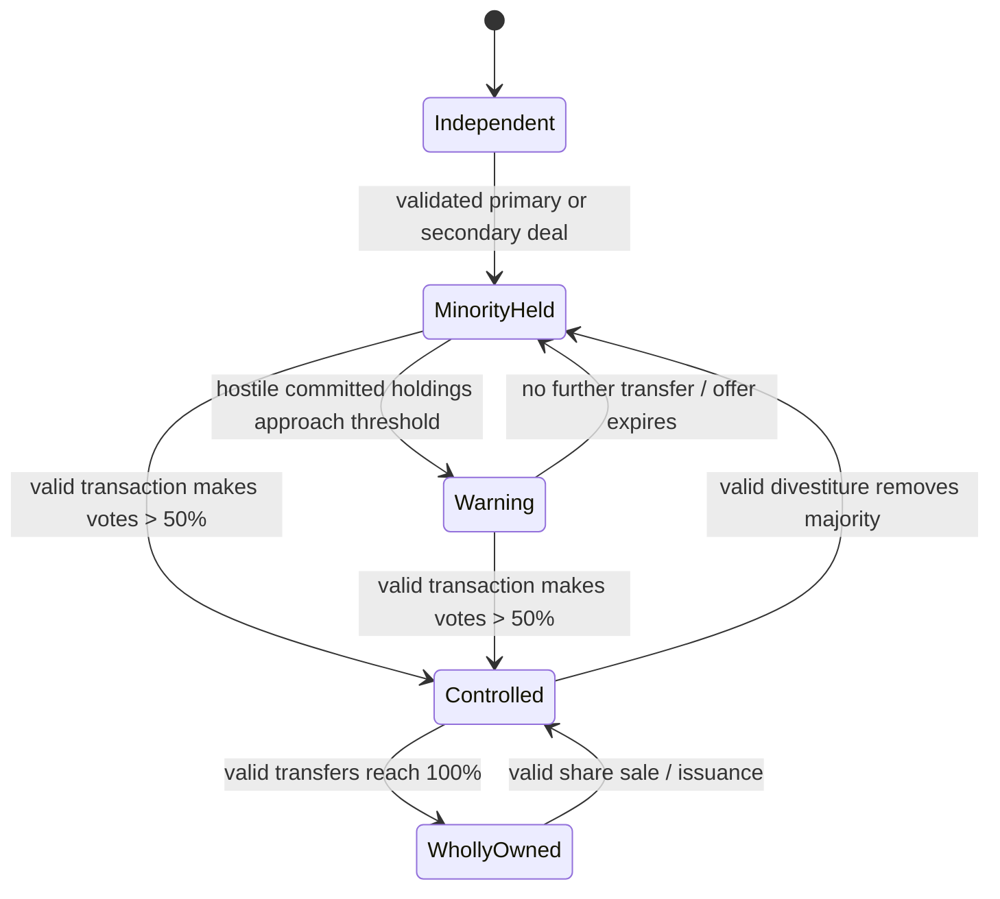

# Founder Legacy & Corporate Ownership — design specification v1

**Date:** 2026-10-11. **Status:** DESIGN review. [User-directed constraints](2026-10-11-direction-v1.md) are distinguished from **PROPOSED** mechanics and **OPEN** approvals below. No gameplay adoption is implied.

## 1. Existing systems and integration conflicts

| Existing local system | Reusable boundary | Conflict / required change |
|---|---|---|
| `RunState` owns one Studio's cash, cycle, Features, releases, employees, Fanbase and finance; `ProjectState` owns the active project. See `patch-notes/scripts/run_state.gd` and [core design](../../design/core-and-studio.md). | Preserve each Studio's gameplay state and the existing seven-card resolver. | Current `RunState` is both player run and Studio; founder, world calendar, multiple Studios and operator selection need separate identities. The active Studio's cycle cannot become a founder-owned ledger. |
| `StudioFinanceLedger` schema 6, `OutstandingExpenses`, `BankLoan` and [banking design](../../design/economy-banking.md). | Exact-cent journals, settled-versus-earned income, typed bills, original-due service, credit and atomic loan actions can be reused per Studio. | Existing Bank quotes require two completed positive settled-sales months and one active loan. A newly founded Studio has no sales; startup financing needs a separately approved underwriting product. Corporate acquisition cash and primary equity receipts need distinct transaction kinds and source IDs. |
| `StudioCheckpoint` and `CheckpointSchema` persist one quiescent Studio, with version/content validation. See `patch-notes/scripts/persistence/studio_checkpoint.gd`. | Reuse validated per-Studio serialization and Studio-safe restoration rules. | A founder/world envelope must capture every Studio, ownership, active operator, AI phase/RNG, pending deals/news and exact transaction IDs atomically. Existing Studio-only Continue cannot be called world persistence. Historical save conversion needs an explicit policy. |
| `campaign_session.gd`, `run_factory.gd`, batch/replay and [Simulation Engine](../simulation-engine/README.md). | Scene-free legal actions, fresh seeds, tapes and parity are a foundation for AI-operated Studios. | Shared-world scheduling, active rival phases, AI policy and population scaling remain OPEN in that thread. Corporate AI must sit above the development command runner, not bypass legal hands. |
| `competitor_definition.gd` and [AI Competitors](../ai-competitors/README.md). | Stable competitor IDs and the selected shared-cycle, separate-ledger, committed-boundary and news contracts can be extended. | The definition is currently metadata, not an ownership entity. G1a and G2–G5 candidates are private/design review; persistent canonical rival gameplay is not complete. Ownership must depend on those world foundations. |
| [Studio Traits](../../design/studio-traits.md), Store, Contracts and employees. | Studio-owned starting selections and obligations remain attached to their Studio; an era tier can select valid new starts. | Current creation mints fixed base/unused-point/trait financing without a named debt/equity source. New-venture financing and historical first-Studio compatibility need a deliberate mapping. Current employee mid-game wage direction is deferred; do not assume its future economics in valuation. |

**Dependency:** establish a valid shared-world time and per-Studio persistence contract before active takeovers or founder migration. Keep each game's Review, income and Feature rules intact until separately approved design says otherwise. Current Store years give a temporal hook, not an approved complete later-era startup package.

## 2. Invariants and scope

1. One `FounderProfile` persists across Studio changes. At most one `active_operator_studio_id` and one manually controlled seven-card session exist at any time. A founder can hold shares in former Studios while their operations remain AI-run.
2. Every cash cent, liability, Feature, employee, release, IP right, subsidiary interest and Contract has a Studio owner. An equity transfer changes owner claims/control, not asset IDs or account balances. Founder career data contains no spendable personal balance.
3. A share has one vote and one equal claim on distributable value. For each Studio, issued units equal the sum of all holder units; no negative units, fractional holder, self-holding, circular corporate holding or unrecorded issuance. `2 * holder_units > issued_units` determines direct majority; exact 50% is not control. Direct and indirect corporate control need the separately approved rule in §11.
4. Primary issuance deposits real contributed cents into the target Studio and changes its total shares. Secondary transfer pays the seller and changes only holder balances. There is no cash creation or asset migration on control change.
5. Corporate AI decisions occur on committed six-cycle boundaries. No menu browsing, failed action, load or free transition creates a corporate quarter or funding event. A transaction either validates and commits once with a stable ID or leaves state, RNG and journals unchanged.
6. Milestone achievements belong to founder career history; victory presentation offers Continue. Ongoing Studio businesses and obligations keep running.

## 3. Proposed state/data architecture

```
WorldState v1 (one authoritative committed calendar)
  world_id, world_cycle, era_catalog_revision, RNG streams, event IDs
  FounderProfile {founder_id, career_studio_ids, reputation_history,
                  milestone_ids, financing_event_summaries,
                  active_operator_studio_id, role/mandate}
  Studios[studio_id] -> StudioEntity
    {RunState-equivalent gameplay/finance/Fans/owned Features/releases/IP,
     AI development session and policy state, status, parent_policy,
     creation-era snapshot, operating_role}
  Ownership[studio_id] -> {issued_units, holders[holder_id] -> units,
                            governance events, transaction IDs}
  AcquisitionOffers[offer_id] -> terms, state, expiry, buyer/seller/target IDs
  ValuationCache[studio_id] -> inputs, method version, value, cycle, dirty reason
  News/milestones -> queued/delivered IDs
```

**PROPOSED:** stable `studio_id` is independent of display name and founder identity. Holder IDs are typed `founder`, `studio`, or pooled `outside_investor`; the last is a passive counterparty, not a simulated person or exchange. Each Studio owns its own finance/credit and AI seed. Founder reputation and financing summaries are read-only historical signals for an underwriter, never a cash ledger. Store assets, acquired IP and subsidiary shares are separate typed properties; parent ownership does not merge their finance books. A cached valuation is a quote input, not an accounting asset or spendable cash.

The world transaction coordinator validates a copy of all affected ledgers, journals, ownership and event queues, then commits one ordered change. Lock the target and buyer/seller records for the transaction; a save captures the entire committed world. Do not infer deals from independent Studio checkpoints on load. All player-visible offers carry immutable IDs, source cycle, valuation version and expiry; accept revalidates price, available funds, cap table and control. Store a corporate-quarter index `floor(world_cycle / 6)` and last evaluated index for exact-once decisions.

## 4. Ownership and financing math

All money is integer cents. **PROPOSED** initial cap table: `S = 1,000,000` equal share units, split according to a separately approved founding allocation. Initial unit count is an engineering convenience, not a share price. Store integer units and use overflow-safe integer comparisons or checked wide arithmetic; never float for majority or dilution.

For positive pre-money equity value `V_pre` cents and actual primary contribution `I` cents:

```
theoretical_new_units N* = S × I / V_pre
issued_new_units N = approved integer rounding of N*
actual investor fraction = N / (S + N)
old holder fraction after = old_units / (S + N)
V_post = V_pre + I
```

The quote must display the quoted and actual resulting fractions and implied issue price. **PROPOSED** rounding is nearest integer with ties to even; reject a quote whose rounding error exceeds an approved tolerance or yields zero units. Recompute and validate at acceptance. Never set `V_post` by multiplying an old share price and a rounded count while also adding `I`; the disclosed amount is the actual cash paid. Zero/negative pre-money cases need a recapitalization rule (**OPEN**), not division by zero or free shares.

**Secondary transfer:** buyer pays `P` cents for `q` existing units; seller loses `q`, buyer gains `q`, issued `S` is unchanged, target Studio gets no cash and `V_post` is unchanged solely by that sale. Buying a partial stake, crossing majority and buying every outstanding unit are the same validated transfer path with different results. For a corporate seller, payment enters that seller Studio's finance journal; a corporate buyer spends only its own cash or a valid named financing receipt. Passive-investor consideration crosses the simulated world boundary and creates no Studio cash. Founder consideration requires the §11 approval. A primary buyer may dilute incumbents across majority only through a valid target-approved issuance; hostile control attempts use secondary transfers unless governance explicitly allows contested issuance.

No dividend or cross-company cash sweep is included in first slice. If added later, each payout must be a separately recorded Studio expense/recipient receipt, pro rata to units, with current bills and loan covenants respected.

## 5. Valuation proposal, with no earnings duplication

At a cached quarterly snapshot, use recognized, **settled versus earned correctly classified** operating data, not financing receipts, principal movements or projected sale proceeds. A proposed transparent model is:

```
E_month = normalized recurring operating earnings per month
         = normalized earned operating revenue - normalized operating expense
E_year = 12 × E_month
EV_operations = M × max(0, E_year)
IP_increment = Σ max(0, PV(forecast IP net receipts) - PV(IP receipts
                   already represented in the normalized earnings run rate))
V_equity = max(0, EV_operations + IP_increment + eligible_cash
                  - outstanding_debt_principal - accrued_unpaid_interest
                  - other unpaid liabilities)
```

`M`, window, forecast horizon/discount, earnings normalization and liquidity haircuts are **OPEN**, not implicit gameplay values. For a first version, recommend a short explicit trailing-window average with documented treatment for partial months and extraordinary one-time receipts. Existing release royalties/sales already in recurring earnings must be subtracted from the IP forecast baseline; only incremental future cash beyond that baseline enters `IP_increment`. This avoids capitalizing the same release twice. An alternative simpler first slice is `IP_increment = 0` for every IP without a separately evidenced incremental opportunity, while retaining an IP inventory for later valuation. IP value is not automatically the Store purchase price or the cost to make a game.

`eligible_cash` is the Studio's actual cash at snapshot; earned unsettled sales are receivables only if separately valued once (recommend excluding them in v1). Debt subtracts unpaid principal and accrued due interest, never unearned future interest. Other unpaid obligations subtract their actual outstanding cents once, including rent/payroll and contractual liabilities. Expense recognition within `E_month` and an unpaid bill on the balance sheet are different dimensions, so this is not double-counting; do not also subtract the same arrear as a second debt line. Subsidiary share holdings are assets whose value may enter the parent's equity calculation, but must be valued on an acyclic dependency order and not counted again as consolidated child earnings. A no-sale/negative-earnings Studio can still have cash or independently valued IP; a distressed value can be zero without erasing debt.

The cached quote stores source cycle, window, normalized earnings components, IP baseline and forecast IDs, cash, liabilities, multiple/version and resulting value. Invalidate on release, settlement, major finance/IP/ownership change, and use a bounded refresh at quarter evaluation or offer acceptance. A target valuation is a negotiation anchor; paid transaction consideration is the authoritative finance fact.

## 6. New-venture financing and banking

**PROPOSED:** at formation create a new legal Studio and an atomic financing plan. The Bank and passive investors quote independently against founder reputation/history, the new Studio's proposed era package and industry conditions. An accepted startup loan credits the **new Studio** and creates its loan/debt schedule; an equity subscription credits that Studio and issues shares. Record each funding source and cash receipt once. Formation fails without enough committed funding to meet the required starting package and immediate obligations. Do not copy the old Studio's cash, credit score, loans, contracts or IP. Founder credit history is a bounded underwriter input, not the new company's credit score; the new company begins with its own credit record.

This startup product cannot silently reuse the ordinary Bank gate requiring two positive settled-sales months. The loan limit, term, rate, guarantee/reputation effect, investor cap and default handling need approval. Existing original-due expense priority, live obligation capacity and no-negative-cash rules apply after formation; debt service and payroll remain with the new Studio. Proposed investor equity is primary issuance with cap-table dilution, not an income receipt. Existing first-Studio `$5,500` base and trait/unused-point financing need an explicit compatibility rule before this replaces startup behavior. No free or duplicated starting grant may arise from the migration path.

## 7. Acquisitions and control

**PROPOSED quarterly pipeline:** (1) refresh stale bounded valuation inputs; (2) filter eligible target/buyer pairs by era, relationship, available buyer funds, ownership graph and policy; (3) score a small top-k set using strategic fit and financing headroom; (4) negotiate or propose a priced primary/secondary transaction; (5) revalidate on acceptance and commit once. Candidate scoring does not advance a card hand or settle sales. A friendly deal requires target governance/seller acceptance; a hostile path buys offered existing shares from willing holders without target board approval. Never award control from a score or story event alone.

Warnings use actual committed hostile holdings and pending credible offers. **PROPOSED** stages: early accumulation, blocking stake and control-threat, with thresholds/visibility **OPEN**. A warning records buyer, target, observed units, issued units, resulting fraction, valuation/offer ID and delivery state; it cannot itself alter ownership. A controlling acquisition occurs only when one holder exceeds 50% of the votes under the approved direct/indirect rule. Full acquisition reaches 100% and may convert to a subsidiary. Existing finance and contracts stay with the target. Parent policies/commissions are separate high-level commands; subsidiary development remains autonomous and uses the same legal simulator.



The transaction validator rejects self-purchases by the target, insufficient buyer funds, oversold units, stale offers, duplicate IDs, buyer insolvency after known dues, invalid control claims and edges that create `A → ... → A` corporate ownership. A parent may own several children; a child may hold no ancestor. Decide whether indirect voting control is computed through the graph or only direct registered shares before allowing multi-level structures (**OPEN**).

## 8. Founder migration, CEO authority and subsidiaries

At a quiescent Studio boundary, freeze and validate the old Studio's exact state; append the founder departure and role transition; assign that Studio an AI development policy; then either appoint the founder as permitted CEO or select a newly financed Studio as the sole manual operator. Outstanding hands, unresolved Contracts and in-flight financial callbacks cannot be stranded. A departure does not forgive bills, accelerate income, duplicate first-Studio trait receipts or remove the old Studio from the market. A founder may own shares in several Studios but has only one manual development session.

```mermaid
stateDiagram-v2
    [*] --> ManualStudio
    ManualStudio --> DepartureReady: quiescent Studio boundary
    DepartureReady --> ManualStudio: cancel
    DepartureReady --> AIFormerStudio: voluntary resignation; commit handoff
    ManualStudio --> ControlLost: committed buyer votes > 50%
    ControlLost --> CEODelegated: controlling owner permits CEO mandate
    ControlLost --> ExitNegotiation: founder seeks sale / severance terms
    ControlLost --> AIFormerStudio: founder resigns
    CEODelegated --> AIFormerStudio: mandate ends / founder resigns
    ExitNegotiation --> AIFormerStudio: validated exit transaction
    AIFormerStudio --> NewVenture: approved loan/equity formation commits
    NewVenture --> ManualStudio: new studio becomes sole operator
```



The founder may remain CEO without majority only through an explicit owner-granted mandate. **PROPOSED:** this mandate defines which Studio actions remain manual, which parent/board vetoes apply and how dismissal is scheduled. It must never grant a second manually controlled team. If the founder stays CEO, the old Studio can remain the one playable team until resignation/dismissal; if the founder migrates, its development becomes AI-run. A voluntary founder departure with majority shares leaves voting ownership intact but transfers day-to-day operation to AI; future shareholder policy commands are high-level only. The exact CEO veto/dismissal and role switching boundary require approval.

Subsidiary v1 retains separate finances, IP, employees, contracts, feature pool, Fans and AI session. Parent policy can set bounded strategic preferences or commission one project with a signed contract and explicit intercompany price; it cannot directly assign cards, seize cash or bypass Store legality. Publishing/Marketing, Research and Manufacturing/Distribution specialization are later phases with distinct budgets and outputs. Intercompany commissions must be symmetric payable/receivable entries and cannot generate net cash by cycling subsidiaries.

## 9. CPU and persistence budget

**PROPOSED:** Keep corporate planning separate from development. At each committed sixth cycle, refresh only dirty or expired valuations, scan indexed plausible target/buyer pairs, and run expensive strategic scoring on a bounded top-k list. Corporate candidate evaluation must not simulate a seven-card hand, advance a Studio cycle, draw mechanics RNG, or settle a sale. Cache keys include Studio finance/release/IP/ownership revisions, world cycle, valuation method and era. Invalidate affected parent valuations when a child value or ownership changes. Offer acceptance refreshes the affected quote even when the quarterly cache is warm.

For `N` Studios, a naive all-pairs scan is `O(N²)` per six cycles; filter by active status, corporate capacity, era and relationship before scoring. Graph-cycle validation traverses relevant ownership edges. Process stable IDs and fixed decision budgets so a time limit defers work instead of substituting a random control event. Historical sales and finance journals may grow without a hard title expiry; any summary must preserve exact obligations, earned/settled totals, valuation inputs, release IDs and replay identities.

Benchmark declared Studio populations and campaign ages on named hardware. Record p50/p95/max corporate-quarter time, total player-cycle time, allocations, cache hit/invalidations, save size/load time and seeded replay hashes. Include dense but acyclic ownership and many aged releases. Numeric population, top-k, milliseconds and memory/save limits are **OPEN** pending upstream shared-world profiling. A performance defer preserves unchanged state and a deterministic retry policy.

## 10. Exploit and edge-case review

| Case | Required guard / unresolved choice |
|---|---|
| Exactly 50%, rounded issuance, multiple buyers | Compare integer votes strictly; quote actual rounded dilution; define multi-holder/coalition control policy before implementation. |
| Primary issue while hostile buyer nears control | Require target governance authorization and immutable offer repricing; no emergency dilution from an unapproved board action. |
| Founder sells shares without personal account | No untracked proceeds or transfer to old/new Studio. Select a direct settlement rule in §11. |
| Buyer borrows to fund takeover | Separate corporate loan quote; no reuse of a target's cash or future settlement; covenant/known-due reserve and debt stay buyer-owned. |
| Insolvent or zero-value target | No division by zero, free controlling shares, debt disappearance or negative share price; approved restructuring path needed. |
| A owns B, B buys A (or longer cycle) | Graph reachability check before any issuance/transfer; reject atomically. |
| Parent and child value each other | Acyclic valuation order; no consolidation plus share-asset double count. |
| Same-cycle two offers/quarterly trigger | Deterministic stable ordering; revalidate later offer against changed cap table/cash; idempotent quarter ID. |
| Quit/load during sale, launch or migration | One world checkpoint after atomic commit; unsaved rollback restores old cap table and AI progress; no orphan studio or duplicate funding. |
| Leaving during live hand/Contract | Defer to safe boundary, preserving card/RNG/obligations; do not cancel to escape cost. |
| Resign/restart repeatedly | Founder ID and career continuity; each new venture needs real financed cash and new obligations; no repeated trait or starter grant without funding. |
| Former Studio releases and intercompany contracts | Stable owner/release IDs, actual legal AI actions, exact-once receipts and expense mirror; old IP never follows founder automatically. |
| Milestone reached during takeover | Persist achievement once in founder profile; present Continue without freezing corporate world or forgiving debt. |

## 11. Approvals required

1. **Founder equity proceeds:** Without personal wealth/account, how should a founder's secondary-sale consideration be represented? Recommended review option: a one-time, nonspendable **formation entitlement** paid directly into a new Studio only as a recorded founder capital contribution at formation, expiring if unused; this is still an economic claim and must be approved. Alternatives: external proceeds never enter gameplay, or prohibit founder secondary sales until a settlement model exists. No rule selected.
2. **Founder initial shares and formation cash:** What founding allocation gives the founder meaningful control, and how are current fixed first-Studio/trait receipts sourced? Recommend grandfathering existing first starts and defining a separate funded subsequent-venture package; exact allocation and backer treatment OPEN.
3. **Startup credit:** What distinct pre-sales underwriting terms, guarantee scope, investor dilution bounds and failure path apply? The ordinary two-settled-month Bank rule must remain intact unless separately changed.
4. **Valuation inputs:** Approve a normalization window, earnings multiple, IP incremental forecast/discount, cash eligibility and treatment of negative earnings/insolvency. No numerical default selected here.
5. **Control/governance:** Direct holder majority versus indirect corporate voting; coalitions; target board authority over primary issuance; CEO mandate/dismissal and whether a nonowner CEO may continue manual development. Strict >50% for majority is already fixed.
6. **Acquisition availability:** Seller willingness, hostile accumulation price/pace, warning thresholds, offer expiry, corporate acquisition lending and takeover defenses. No percentages other than majority are approved.
7. **World and migration:** Exact quarter ordering against monthly finance/AI turns, historical save conversion, safe departure boundaries, first later-era Studio content and former-Studio policy/recovery. The shared-world AI policy and scaling are still OPEN upstream.
8. **Subsidiary commissions and milestone set:** Which first-slice parent commands and milestones exist, and what intercompany prices/approval rights apply? Specialization economics remain future work.

These questions gate numerical gameplay approval. The [phased plan](HANDOFF-v1.md) sequences implementation once the relevant answers and upstream systems exist.
