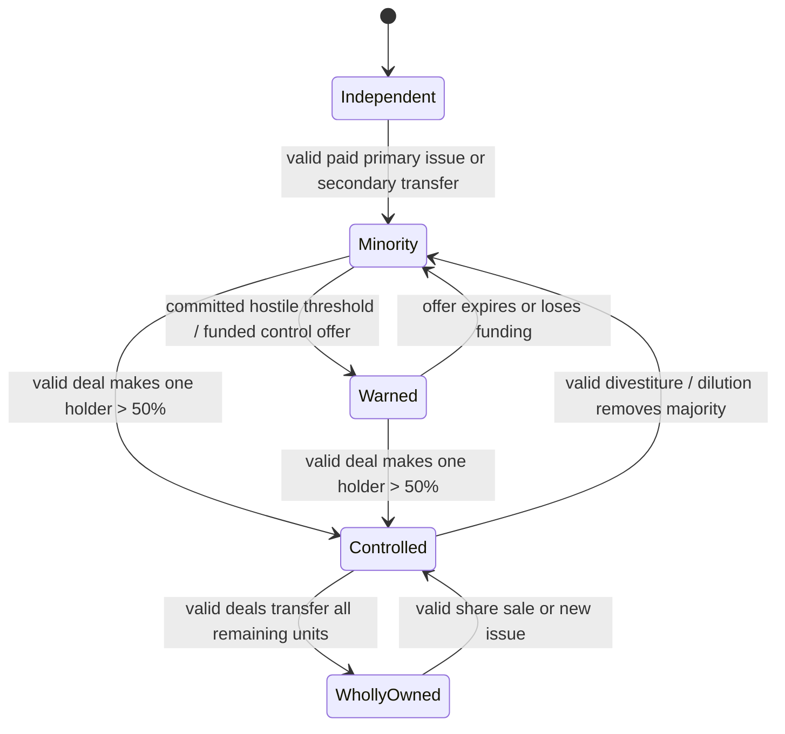
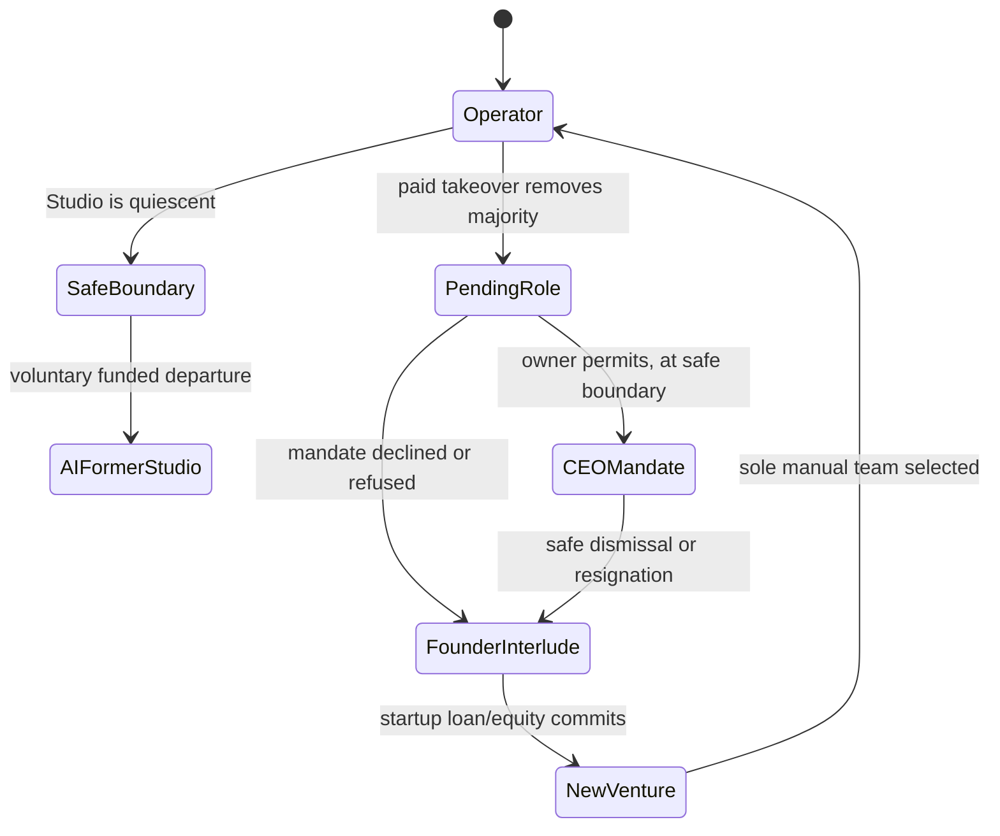

# Founder Legacy & Corporate Ownership — selected design specification v2

**Date:** 2026-10-11. **Status:** SELECTED DESIGN under the user's architecture delegation; unimplemented. The later [share-sales and control decision v2](2026-10-11-share-sales-and-control-v2.md) amends founder consent, other-holder transfers, voluntary sale requests and offer timing in §§3, 7–8. The [founder role transition decision](2026-10-11-founder-role-transition-v1.md) details §8's CEO mandate, transaction/handoff boundaries and Interlude flow; apply both with this specification. This supersedes the **PROPOSED/OPEN architecture choices** in [v1](SPEC-v1.md), while preserving its source audit and exploit inventory. [Decision record](2026-10-11-architecture-decisions-v1.md) lists alternatives and the selected rationale. Numerical terms explicitly labeled **CANDIDATE/OPEN calibration** remain unapproved balance values. This document does not modify AI Competitors' separate OPEN G1–G5 policy.

## 1. Reuse and hard boundaries

The existing [core Studio design](../../design/core-and-studio.md) and `patch-notes/scripts/run_state.gd` supply the seven-card project rules, Studio resources, release history and exact productive-action sequence. [Economy/Banking](../../design/economy-banking.md), `studio_finance_ledger.gd`, `outstanding_expenses.gd` and `bank_loan.gd` supply exact-cent journals, typed due bills, credit, ordinary loan schedule and original-due servicing. [Simulation Engine](../simulation-engine/README.md) supplies legal scene-free campaign commands and replay; [AI Competitors](../ai-competitors/README.md) supplies the selected separate-rival/committed-cycle direction. [Release engineering](../../design/release-engineering.md) supplies Studio-only checkpoint and backup semantics.

The new world layer must not treat the current single `RunState`, `CompetitorDefinition` metadata or private AI simulator candidates as an already implemented multi-company world. Existing Studio mechanics remain the only source of legal development effects. Corporate ownership never changes Feature/release/scoring rules by itself.

## 2. Entity model and invariants

```
WorldState {world_id, world_cycle, era_revision, quarter_cursor,
            founder_profile, studios, ownership_ledgers, offers,
            corporate_event_log, pending/delivered news, world_rng}
FounderProfile {founder_id, career_studio_ids, operated_periods,
                reputation_events, milestone_ids, financing_summaries,
                active_operator_studio_id?, mandate_id?, interlude_state?}
StudioEntity {studio_id, display_name, founding_event, RunState-equivalent,
              development_session/AI policy, per-studio RNG, operating_status,
              parent_policy, owned-IP records, subsidiary-share assets}
OwnershipLedger {studio_id, issued_units, holders[typed_holder_id] -> units,
                 transaction_ids, governance_policy_version}
```

Each Studio has a stable legal ID and its own cash, debt, credit, employees, Fans, owned Features, IP, contracts, releases and subsidiaries. The founder has history and an operator pointer, never cash, a wallet, personal debt or a spendable exit entitlement. Zero or one Studio has a manual seven-card team at any instant; the former Studio continues under legal AI commands when the founder migrates. An AI Studio founder is a stable `founder` holder ID without an individually simulated consumer economy; pooled outside investors have stable typed IDs. Every entity uses the same cap-table, valuation, funding and transaction validator.

`world_cycle` is the sole time authority. Every active Studio's calendar/finance projection is reconciled to it, including an idle AI Studio. New entrant IDs, releases, loans, offers, ownership deals and milestones are immutable event identities. The committed world transaction is atomic: validate changed Studios and ownership together, then publish one state revision and event list. Invalid, stale or duplicate requests alter no cash, shares, bills, RNG or event delivery.

## 3. Equal shares, control and transaction math

At incorporation, issue exactly **1,000,000 equal units**. The incorporation subscription is a separate negotiated founding allocation because there is no preexisting company or positive pre-money denominator. A bank-only package assigns all units to its founder. A normal outside-equity package assigns 600,000 founder and 400,000 pooled outside-investor units; a distressed backstop can put investors above 50% and attach a founder CEO mandate. These allocations are initial **CANDIDATE** economics, to be tested before implementation. The investor contribution enters only the new Studio's financing journal; an actual loan enters that Studio's loan account and cash. No founder reputation or labor is booked as cash or transferable IP.

For an established Studio with positive pre-money equity value `V_pre` cents, existing `S` units and primary investor contribution `I` cents, calculate `N* = S × I / V_pre`. Issue integer `N = nearest_even(N*)` after checked exact rational arithmetic and a disclosed rounding tolerance. The new investor owns `N/(S+N)`, each old holder owns `old_units/(S+N)`, and the **quoted post-money value is `V_pre + I`**. Actual per-unit issue price is `I/N`; disclose any rounding deviation, reject zero units/overflow/stale funding, and recompute immediately before commitment. Example: `S=1,000,000`, `V_pre=$10,000`, `I=$2,500` gives `N=250,000`, `V_post=$12,500`, investor 20%; a prior 60% founder is diluted to 48%. The target receives $2,500; no old shareholder receives it. A target-authorized primary issuance requires affirmative votes representing more than 50% of outstanding units. It cannot be used as an unapproved hostile dilution tool.

A secondary transfer of `q` units at positive exact price `P` keeps `S` unchanged. Buyer pays seller; target receives nothing. A corporate payer/recipient posts a real cash journal. Passive/founder consideration crossing the modeled Studio boundary is recorded as `external_owner_settlement` with price and counterparties, not a simulated personal balance. Founder shares get the same per-unit economic terms as other equal shares, but proceeds cannot fund a later venture. A negotiated exit can pair a founder secondary sale with resignation/CEO terms; it does not move target assets. A full acquisition is transfer/issuance resulting in one holder owning all issued units; debt and contracts remain target-owned.

No individual or corporate holder may own its own shares. On every transaction, enforce `issued_units = sum(holder_units)`, nonnegative unit counts, checked arithmetic, valid source cash, unique deal ID and no corporate ownership cycle. A holder directly controls a Studio only when `2 × holder_units > issued_units`; exact 50% and informal coalitions do not confer control. Corporate votes held by a parent may be directed by that parent's controlling holder, creating an operational control chain through the acyclic graph; the child's direct cap table remains authoritative and indirect economic percentages are not rounded into new votes. When no holder directly controls, governance actions require an affirmative majority of outstanding votes. First-slice stock has no preference, options, dividends, exchange or retail order book.

An established zero-value Studio cannot use the normal primary formula. A positive-cent rescue recapitalization with creditor/shareholder consent is a later contract, not an automatic free majority. Existing debt never disappears on a zero or full acquisition.

## 4. Valuation without counting release earnings twice

Use a **separated-earnings sum of parts**. Complete-month operating earnings from external, recurring non-IP services/publishing are normalized over a bounded window. Explicitly remove all released-title sales, IP royalties, financing receipts, debt principal, interest and intercompany payments from that earnings numerator. Ordinary external operating expenses attributable to those services stay in it. One-time Contract receipts are valued only through a specific enforceable future claim, if any, not multiplied as recurring earnings.

```
E_nonIP_annual = 12 × (sum eligible completed-month non-IP operating margin / n)
EV_nonIP = M × max(0, E_nonIP_annual)
IP_value = Σ PV(future external net cash attributable to each owned right)
           + PV(separately evidenced unlaunched IP rights)
V_equity = max(0, EV_nonIP + IP_value + eligible_studio_cash
                  + value_of_owned_subsidiary_shares
                  - outstanding_debt_principal
                  - accrued_unpaid_interest
                  - other_unpaid_liabilities)
```

For released titles, project only their remaining legal lifespan from frozen launch and actual age data; revenue remains **forecast** for pricing, never spendable until earned/settled. Deduct direct costs associated with that forecast. Frozen pre-1980 historical titles in the AI Competitors archive have no post-start sales stream and therefore contribute no invented IP cash flow. Unreleased concepts, owned Features and brand reputation receive zero standalone IP value until an independent, documented cash-flow basis exists. Rights sold or licensed elsewhere must not be valued twice. A child is valued before its parent in an acyclic bottom-up pass; its share value enters the parent's assets, while child sales and intercompany transfers do not enter parent operating earnings. An expense already recognized in non-IP earnings may still leave an unpaid liability on the balance sheet; these are distinct, but the liability is subtracted once only. Unearned future loan interest and unsettled sales are excluded from cash; any receivable extension must be separately versioned and counted once.

The multiplier `M`, completed-month window, IP horizon/discount and any liquidity adjustment are **OPEN calibration**, not inferred from private AI experiments. The quote stores component cents, source release/IP IDs, method version, cache revision and cycle. These inputs make a transaction price auditable; the actual paid consideration can differ from the valuation anchor under a valid seller/governance agreement. Invalidate finance, release, IP and subsidiary dependencies on relevant commits; force a refreshed affected quote before offer acceptance.

## 5. Banking and founder migration financing

The **ordinary Bank** keeps the locked two-consecutive-positive-settled-sales gate, exact capacity after rent/live obligations, one-active-loan limit, original-due servicing and current selectable terms. New ventures use a distinct `startup_loan` eligibility path through the Banking service: evaluate the founder's verified operated-period credit history, reputation events, industry conditions and an era-specific minimum viable Studio budget. This is an underwriting input; the old Studio's credit balance or liability is not copied. The accepted loan credits and obligates the **new Studio**, uses the established exact-cent loan/payment machinery and occupies its one active-loan slot. The candidate first-slice payment schedule/rate is the existing Bank schedule; the approved loan amount is separately capped by startup underwriting. No future sales are credited as cash or repayment.

The underwriting **formula structure** is fixed, while its coefficients await calibration. Let `B_start` be the sum of the published legal setup purchase/hand costs, scheduled rent and other known bills through a declared finite first-project plan, plus an explicit contingency. Let `Y_era` be an authored/observed external industry monthly receipt benchmark, never this new Studio's income. Versioned fixed-point `F_credit`, `F_reputation` and `F_industry` derive from verified founder-operated history and the current industry state. Then `risk_receipts = floor(Y_era × F_credit × F_reputation × F_industry)` and `startup_service_capacity = floor(max(0, risk_receipts - new_studio_rent - scheduled_new_studio_obligations) / 4)`. Use checked arithmetic throughout. Choose the largest quoted principal whose **maximum actual scheduled installment** fits that capacity and whose principal does not exceed `max(0, B_start - committed_equity_cents)`; the player may choose a smaller offered amount/term. The authored initial `Y_era`, finite plan/contingency and factor tables are trial parameters requiring evidence. This risk estimate authorizes a debt contract only; it is not earned sales, a player cash receipt or an exception to the ordinary Bank's actual-settlement gate.

The Banking service may broker a combined package: subscribed outside equity plus a startup loan. At formation, check that actual committed receipts cover the published startup budget and immediate known dues, then create the Studio/cap table/loan/cash atomically. The quote records era catalog, specialty, founder track record, industry condition, amount, investor allocation, debt schedule, expiration and source IDs. Declined or stale quotes change nothing. A minimum investor-backed package remains available in Founder Interlude to avoid a dead career state, limited to one accepted backstop formation per founder-quarter. Its investor holds a controlling stake and grants the founder a disclosed temporary CEO mandate for ordinary development. That money is investor equity paid to the new Studio, not founder cash. Initial stake, amount, mandate length and underwriting coefficients are **CANDIDATE balance**. The founder can take a better bank/equity mix when qualified.

The first current Studio's `$5,500` base and trait/unused-point financing are already logged as financing, with no current loan liability. A supported legacy checkpoint converts those exact already-recorded starting receipts into a **historical outside-equity attribution** in the world cap table, without adding cash, debt, Fans or a transaction callback. The first new-world Studio should use an explicit formation financing contract with an equivalent player-visible starting cash outcome until separate balance approval. Later ventures do not replay the `$5,500` grant, point-to-cash or Family Funding receipt automatically; any such receipt must appear as a genuine new subscription/loan term. Historical College Dropout/Graduate Studio debts remain with the old Studio; a founder cannot select the same biographical education trait repeatedly for new debt/points. Other new Studio traits require a new legal Studio creation selection and owner-specific finance provenance.

Era-appropriate start means current-year Store/Genre/Theme eligibility and a priced contemporary starter path, not free ownership of later-era Features or prior Studio IP/Fans. Existing yearly Store gates are reused; no additional future node is activated by this architecture. The new Studio owns its specialty/starting roster, contracts and subsequent IP. The founding budget is calculated from known legal setup/play/rent requirements and is published in the financing quote; its exact reserve target needs bounded economy evidence before canonical adoption.

## 6. Shared world transaction order and persistence

For each successful player productive action, perform one world tick:

1. Preflight the player's legal command against the opening committed state and finance. A failure creates no tick.
2. Commit that player's direct legal effects. Give each active AI Studio, in stable Studio-ID order, at most one legal productive command opportunity with bounded legal zero-cycle setup/exit/launch. AI choices use that Studio's own **previously settled** cash and RNG. A blocked Studio idles without production, but its calendar still advances.
3. Advance the single world cycle once. For every Studio, accrue all already-live title earnings and, on a month boundary, settle earned sales, service typed bills in the existing order and update credit once. A title launched during this tick starts at release age zero and cannot earn Month 1 income on that same boundary. No Studio's current direct action spends a later settlement from this tick.
4. On cycles divisible by six, run the deterministic corporate evaluation **after** finance closure. It can use cash just settled for a new end-of-tick ownership deal, but cannot retroactively fund an earlier development action. Invalidate/refresh quotes and commit valid deals in stable order. Register milestones and queue news; deliver only at the existing first safe player-facing point, with hostile warnings keyed once.
5. Capture an automatic world Continue checkpoint at a quiescent founder Studio boundary or after a committed Founder Interlude action. Failed saves block departure under current checkpoint policy. An unsaved mid-project rollback restores every Studio's AI progress, finance, shares, offers, news and founder state from the same world snapshot.

This requires an adapter that advances **idle** Studio finance when the world advances; the current single-RunState action path does not provide a multi-company calendar. The implementation must prove parity for player actions and exact-once rival bills/settlements. A Founder Interlude can commit a purposeful `seek_backing` career action to advance a world cycle while no manual team exists; it yields no founder cash or development card and cannot be issued by Studio menu browsing. Formation offers refresh at deterministic boundaries. This is a new career-mode action, not permission for a free Studio Wait.

The world envelope stores versioned founder, Studio, ownership and event state with a previous-valid backup. It stores accepted-offer source snapshots and IDs; derived valuation caches may be rebuilt deterministically. A pure conversion of an **exactly supported/validated** old Studio checkpoint wraps it in a one-Studio world and synthetic historical cap table without rewriting the source bytes until a later normal committed save. Unsupported/corrupt bytes remain intact and incompatible. Founder Interlude is a new safe checkpoint kind; no mid-hand or active-Contract Continue is introduced.

## 7. Corporate acquisition policy and warnings

Corporate AI acts once per completed six-cycle quarter, separate from each Studio's legal card policy. Refresh dirty valuations, use indexed filters for active, eligible, acyclic and sufficiently funded buyer-target-seller combinations, then score a fixed small candidate quota using strategic fit, liquidity and price. Stable IDs and fixed work-unit quotas govern ties/deferral; elapsed wall-clock time never changes game decisions. At most one new buyer-target proposal per buyer per quarter is the first-slice rule. Existing offers revalidate at acceptance against cap tables, seller units, cash, known dues, quote version and graph reachability.

Friendly primary/secondary deals require target governance and seller consent as appropriate. A hostile attempt means the target board did not invite it; it can buy only voluntarily offered existing shares from passive or corporate sellers and cannot force the player founder to sell. If passive float is insufficient to cross >50%, hostile control requires later founder sale, another valid dilution, or a different shareholder structure. Price is positive exact cents; passive/corporate reservation prices and any takeover premium are **CANDIDATE/OPEN calibration**. A buyer may use its own settled cash, including proceeds of a valid ordinary Bank loan already accepted; no target cash, forecast sales or special acquisition loan exists in the first slice.

The quote math starts with `base_package_cents = max(1, ceil(V_equity × offered_units / issued_units))` using checked integer arithmetic. Seller-specific reservation and friendly/hostile premium rules may raise the actual offer, never lower it silently. The offer stores `actual_price_cents`; at acceptance buyer available cash after already-due bills and the AI's declared near-term reserve must cover that exact price. A founder seller sees and explicitly accepts or declines the actual terms. The premium, passive reservation and AI near-term reserve are calibration inputs, not ownership shortcuts.

Warn once when the same hostile buyer's **committed** target holdings first cross candidate 25% and 40% thresholds, and when a funded live offer could cross >50%; show exact units/fraction and buyer/target identity. A credible pending-offer warning does not grant shares. Rejected/expired offers cannot move control. A corporate controller may set bounded high-level subsidiary policy after a valid majority transaction, but the target's own Studio ledgers and AI development survive. Full acquisition reaches 100% and keeps the subsidiary legally separate.



## 8. Founder transition, CEO and subsidiaries

Voluntary departure is requested at a quiescent Studio boundary and may enter Founder Interlude or atomically select an already financed replacement Studio. It leaves the old Studio's cash, debt, Features, employees, IP, Fans, subsidiaries, research queue, releases and contracts intact and hands its operations to the AI. Founder milestones, reputation, operated-period history and compact financing-event summaries persist. A founder may retain equity in the old AI-run Studio, but this creates no second manual team and no direct cash claim. A later return to that Studio requires majority owner authority or a new CEO mandate, quiescent boundaries for the old and new operator sessions, and surrender of any other manual operator role.

An acquisition changes voting control **at its paid transaction commit**. If the founder is in an unresolved development/Contract phase, a limited continuity mandate lets the current work reach the next safe Studio boundary without letting the founder authorize new equity, loans or M&A. At that boundary, the controlling owner may offer a CEO mandate. Under an accepted mandate the founder may manually direct this one Studio's ordinary legal development work, while the owner reserves governance and high-level policy; there is no personal CEO salary/account. Dismissal and voluntary resignation are queued to a safe Studio boundary. A negotiated exit is a priced founder-share transfer plus role agreement; target assets never follow the founder. Without a mandate, the old Studio is AI-operated and the founder can enter a financed new venture or the paused Founder Interlude.



An acquired subsidiary continues autonomous legal AI development. Parent policies may set Genre/project priorities, risk posture or a funded project commission, never individual cards. A commission is a signed intercompany contract: payer reserves and spends its own cash, recipient records a receipt only for valid delivery, and the two journals carry mirror IDs. Internal transfers are eliminated from group valuation's external earnings. Game Development is the first-slice operating role; Publishing/Marketing, Research and Manufacturing/Distribution are named future specializations needing their own service/action economics. No acquired Studio becomes a second manually playable development team.

## 9. Exploit guards, CPU and proof obligations

The validator rejects exact-50% control claims, oversold/negative shares, stale prices, duplicate IDs, insufficient buyer cash after known due reserve, self/circular corporate holdings, zero-value ordinary issuance, target-financed self-buyouts, same-event double payouts and intercompany invoice loops. If two offers compete for the same shares or cash, commit one in deterministic order and revalidate the next. Player refusal of a founder tender is respected. A founder cannot exit an unfinished hand/Contract or reselect one-shot education traits to mint financing. The old Studio's liabilities remain enforceable after every transition.

Corporate cost is bounded by revision-keyed value caches, era/status/funding indexes and a fixed scored-candidate quota, with acyclic reachability checked on an actual transaction. An `N²` all-pairs scan is not acceptable as the ordinary per-quarter path. Fixed work-unit deferral is saved so seeded replays match across machines. The exact Studio population, quota, p95 cycle/quarter time, memory/save-size budget and long-history compaction limits require measurement on declared hardware; no private one-Studio simulation establishes them. Keep historical identity/finance detail sufficient for exact current state and audit even if inactive companies are archived for performance.

Before adoption, prove ownership/cash conservation with exact-cent examples, repeated primary dilution, all control boundaries, hostile warning idempotence, graph rejection, simultaneous offers, financing quote/stale rejection, startup debt service, founder CEO/migration and subsidiary finance. Run seeded fresh-process world replay, current player-source parity, save/backup/rollback checks and declared population benchmarks. These are proposed acceptance gates, **not checks run by this design thread**. Milestone events are founder-owned once-only records; their victory screen always permits Continue. Specific milestone thresholds are content/balance work, not an end-state rule.

## 10. Status and remaining calibration

The architecture choices above are selected under user delegation. The first-slice allocation shares, warning thresholds, distressed mandate terms, passive reservation/premium, startup underwriting coefficients, earnings window/multiple, IP discount, era funding budget, corporate candidate quota, AI action details, incumbent cohort and numeric CPU/population limits require source-pinned experiments and/or their owning thread's design work before gameplay adoption. No existing LOCKED Bank/Store/employee/AI rules are silently changed. [Phased implementation handoff v2](HANDOFF-v2.md) keeps adoption separate from design completion.
