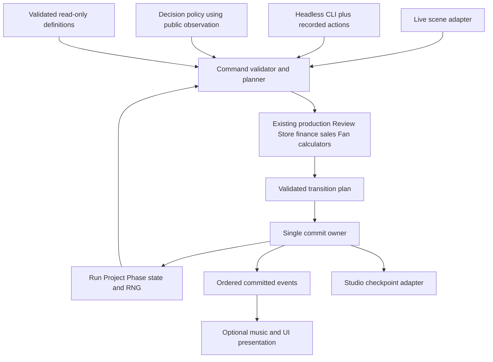

# Headless Simulation Engine — architecture assessment v1

2026-10-10, America/Los_Angeles. **CANDIDATE architecture; source audit only.** No extraction, gameplay/UI/test-harness edit, simulation, parity run or benchmark was performed. This document answers [HANDOFF](HANDOFF.md) and [REVIEW-v1](REVIEW-v1.md). Implementation requires a separate authorization. Existing rules and AI OPEN decisions retain their status.

## 1. Source pin and recommendation

Audited shared dirty `main`, HEAD `41c87c76fb4d3c06a5332d93f0e7b0997007475d`. HEAD alone is not the implementation examined. [545-file SHA256 manifest](source-pin-2026-10-10-v1/manifest.json), [worktree status](source-pin-2026-10-10-v1/status.txt), and [tracked source/design diff](source-pin-2026-10-10-v1/tracked.diff) pin the local state. `runtime-source.zip` preserves the inspected scripts, scenes, data, resources, project configuration and release-gate tool, including untracked source. Its SHA256 is `3edf2ee26f9282ebfe95803e0e49162b4fb3a1cbbe8deae026d83393a80a84fe`. It is an audit source archive, not a complete playable package: imported resources, audio/art assets, executables, caches and saves are outside this archive.

The initial ordinary status listing had328 entries; tracked diff summary was75 files,2,006 insertions/522 deletions. Expanded untracked status encountered Windows long-path warnings in older findings shader caches. It is not an exhaustive cache inventory. The explicit source manifest has no such exclusion within its named roots. Existing edits and `.codex-godot-temp` were preserved.

**Recommendation:** retain Godot headless GDScript and evolve the current state/calculator code into one authoritative command resolver used by live scenes and a CLI. Do not port mechanics into Python or build a parallel balance model. First extract only the shared **validated Design/Alpha hand production calculation** described in §7. Do not begin with world scheduling, save migration or a wholesale phase rewrite.

## 2. Observed ownership and coupling

Paths below are relative to `patch-notes/scripts/`; line numbers refer to the pinned source. RefCounted means independent of a scene instance, not necessarily pure or free of file I/O, signals, mutable references or environmental randomness.

| System / source anchor | Current authority and mutation path | Boundary to preserve/extract later |
|---|---|---|
| Definitions: `cards/card_data.gd`, `cards/card_database.gd`; `cards/feature_store_catalog.gd`; `primitive_predevelopment.gd:8–38` | CardData is mutable RefCounted; CardDatabase is a Node loader/query service. Catalog/predevelopment helpers read `res://` JSON. Prepare-project constructs a ProjectState and freezes owned supply. | Load/validate definitions once in an adapter. Publish a read-only-by-contract catalog. Do not pass artwork, CardView or mutable shared CardData to policies. File access is headless-capable but not pure resolution. |
| State: `project_state.gd:23,93,126,180`; `run_state.gd` | RefCounted mutable objects; integer Core/Scope, float Bug Pressure, phase finalization/history, run cash, ownership, familiarity, sales, Fans, employees, offers and RNG. Signals publish changes. | Reuse their rules first. Active candidate pool, selected instances, priorities and pending corrective cards are partly scene-owned; these must eventually become explicit phase data. |
| Pre-Development: `gameplay.gd:399–464` | Validates identity/priorities/finance, flushes departure checkpoint, snapshots RNG, prepares project/snapshots, constructs Design, commits one run cycle, installs project/scene. New project remains at project cycle0. | Scene construction currently participates in success. Separate prepare/commit from destination rendering only after matched failure tests. Preserve RNG restoration and project serial allocation. |
| Design: `phases/design_phase.gd:565–628,843–951` | Validates four selected CardViews and finite IDs, calculates printed primary/secondary/Scope/pressure, quotes costs/Lean/employee planning, plans refill using deal RNG, commits via RunState callback, then publishes refill and popup. | Pure scoring is embedded in Control. Pool legality, selection identity, tutorial deals, replacement planning and signal/presentation work remain coupled. Failures restore deal RNG in explicit paths. |
| Alpha: `phases/alpha_phase.gd:433–457,805–1008` | Similar hand boundary; Design carryover, separate Alpha pressure and finalization; pending playtest snapshot modifies next replacement construction. | Percentage targeting uses project Review standards; Alpha priority tie then fixed Core order. Hand selection and candidate creation still use scene instances. |
| Current Balanced: `cards/balanced_production.gd`; Design896/Alpha936 | Already shared RefCounted helper: positive hand-local total, inclusive±15% of mean, original-total split with Graphics/Sound/Technology/Design remainder order. Feature requirement and Specialization precedence remain in phase callers. | Reuse this helper; never recreate cumulative20%/×1.20 behavior. The latest change is newer than the108-suite/export evidence. |
| Deals/redraws: Design305/417, Alpha525/586, Beta261 | Seven current candidates, four selected; three retained instances and four replacements after play. Finite Feature identities and duplicate renewable Pass instances differ. Weighted pools/ordering and controlled-roll hooks are phase-local. | Use stable candidate-instance IDs, not just card IDs. Preserve selection order, retained pool order, exclusions, weighted roll count and tutorial overrides. UI sorting must not silently become a new scoring/RNG order. |
| Beta: `phases/beta_phase.gd:535–578,637–768,807` | Preflights replacement and insight streams; restores both on rejection. Commit applies corrective Core gains, all Search requests before all Debug, Marketing, reveals, exhaustion and project cycle; RunState applies cash/calendar. | Explicit ordered operations required; a generic iterate-cards reducer could incorrectly interleave Search/Debug. Corrective Passes and Beta synergies are separate from Design/Alpha Balanced. |
| Phase exits: `gameplay.gd:205–288`; phase finalization methods | Scene identity/parent checks plus finalization guards; stochastic rounding/variance and launch-work rules. Free transitions must not require affordability of a hypothetical productive cycle. | Model confirmation/finalization separately from productive commands. No hidden calendar tick on Begin Alpha/Beta, exit, launch, browse or Continue. |
| Release: `gameplay.gd:293–350,465–503`; `phases/studio_phase.gd:376–403`; `run_state.gd:775–835` | Review→Awareness→market→units→revenue results commit in stages. A Launch scene is instantiated for validation; Studio `setup` registers the release, consumes keyed Promotion, updates Fan title history/publisher eligibility, then checkpoint entry follows. | Calculators are reusable, but the entire launch is not one pure atomic resolver today. Remove registration-from-view-setup only in a later gated extraction. Freeze results once; no launch cash and no rerating old titles. |
| Store: `run_state.gd:373,528–593`; `cards/feature_research.gd` | Current quote equality guards. Admission deducts down payment at zero cycles; Research pays FIFO head through central productive action and grants ownership at completion. Resourceful claims, parent familiarity and current owned supply matter. | One authoritative quote/execute path. Future settlement cannot fund an unaffordable installment. Definition unlock and next-project supply are distinct from draw/play. |
| Calendar/economy: `run_state.gd:1199–1325` | Plans each existing title's next cycle, earned/settled cents, Fan plan and finance before direct callback. Commit order: direct effects/cash, paid Contract completion, run cycle/redraw refresh, planned sales/Fans, payable cash, bill payments/ledger, publisher refresh, signals. | Keep one time/cash owner. `_productive_cycle_in_progress` and `_publishing_cycle` prevent reentry, not arbitrary callback rollback. Signal listeners must not become resolvers. |
| Finance: `finance/studio_finance_ledger.gd:41,252,379` and bank/education/employee helpers | RefCounted plan/validate dictionaries, typed exact-cent actions/transactions, original dues, partial/late history, credit, interest/principal separation. Automatic priority rent→payroll→mixed Bank/education by due date, Bank first on same date; voluntary education payoff has its own approved reserve ordering. | Reuse ledger planning. A simulator must not approximate monthly profit as cash or implement a second bill sorter. Preserve overflow/rejection guards and report semantics. |
| Sales/Fans: `sales/released_game_sales.gd:116`; `fanbase/studio_fanbase.gd:36` | Data-only planners. Sales age/organic/campaign accounting; Fan plan sorts textual title IDs, uses cumulative unit/loss targets and publishes monthly, with frozen launch-Fan exposure. | Keep earned versus settled amounts and half-month/month boundaries exact. Rates remain ACTIVE/TRIAL, not calibrated by this audit. |
| Contracts/publishers: `contracts/contract_state.gd`; `run_state.gd:1048–1112,802` | ContractState plans/commits legal hands and half-unit scores; RunState owns direct payout provenance and completion/promotion bookkeeping. ContractPhase still deals/views. | Reuse contract-specific mechanics; do not apply integer Design Balanced to half-unit Contract Specialization. Promotion award/consumption and release/offer IDs must remain once-only. |
| RNG: `persistence/run_random.gd:4–29` | Nine run-owned streams: snapshot, review, design_deal/finalize, alpha_deal/finalize, beta_deal/insight, contract_deal. Saves preserve seed and state; constructor randomizes, standalone phases have fallback randomization. | Seed alone is insufficient. Pin Godot4.7.1 RNG algorithm and each stream state/order. Live run/project identity initialization also uses random IDs; fixture must pin identity as well as RNG. |
| Continue: `persistence/checkpoint_coordinator.gd:14–94`, `studio_checkpoint.gd:5–55`, codec/store | Coordinator Node listens to committed signals, defers Studio flush, blocks departure on failure; adapter/codec/store handle typed validation, lossless data, generations/lease/atomic publication. Capture rejects active Contract/transient mutation; Studio eligibility also belongs to coordinator. | Keep filesystem/lease out of mechanics. Studio-only durable save remains; active-phase simulation snapshots are a separate test format and never player Continue. |
| Presentation: `ui/hand_presentation.gd:100–166,195–267`; audio transport | Action commits before playback. Corrected music position drives only visible score/bounce/transfer timing; cancellation restores displayed authoritative state. Busy state/scene transitions still gate input. | Presentation consumes committed results/events. No core dependency on AudioServer, frame time, Tween, Node, CardView, await or wall clock. UI acknowledgments may release input but cannot award score or pay bills. |

### Atomicity and retrigger qualifications

`complete_productive_action` preflights run consequences but does **not** clone and roll back arbitrary direct callback mutations if that callback partially changes state then returns false. Existing callers rely on their preflight and nonfallible commit ordering. This is an architecture hazard, not a reproduced gameplay defect. Likewise staged launch result commits need failure-boundary characterization before calling the whole launch atomic.

No general repeat-effect/retrigger resolver or effect field was found in current runtime scripts/card data. `verify_feature_store.gd` calls repeat familiarity credit a “Retrigger”; it tests no duplicate project credit. Repeated renewable Pass instances, specialization visual bonus steps and duplicate UI callbacks are not evidence of a generic retrigger mechanic. Initial parity covers their actual ordering and once-only behavior. A true retrigger fixture is **not currently available**; require an authoritative existing example or a separately approved effect rule before adding one. Do not invent a retrigger feature to satisfy a test checklist.

## 3. Proposed module structure — CANDIDATE



Proposed files below are future boundaries, not created modules or approval to implement them:

| Proposed boundary | Responsibility / reuse |
|---|---|
| `simulation/definitions.gd` | Validated catalog snapshot and IDs/revision, loaded by application/CLI bootstrap using current loaders. No duplicate ledger definitions. |
| `simulation/phase_state.gd` | Explicit phase/substate, ordered candidate instances, finite supply/exhaustion, priorities, pending corrective choices, tutorial state and legal transition flags. RunState/ProjectState remain initial state owners. |
| `simulation/command.gd`, `transition_plan.gd`, `event.gd` | Versioned input/plan/result contracts; no scene references/Callables in serialized commands. |
| `simulation/production_hand.gd` | First candidate extraction: shared final Core calculation using existing Balanced helper and Specialization rule; narrow scope below. |
| `simulation/engine.gd` | Validate expected revision/actor/action, prepare on isolated state/RNG, commit validated transitions, publish ordered events. Later coordinates existing RunState economics rather than copying formulas. |
| `simulation/policies/decision_policy.gd` | `choose(public_observation, legal_actions, policy_rng)` returns a command or explicit defer. Human adapter and recorded-action policy first; AI ranking rules remain gated. |
| `simulation/cli.gd`, `simulation/trace_codec.gd` | Godot headless bootstrap, scenario/replay runner, versioned JSON trace and CSV summaries. Use existing lossless codec conventions with a separate simulation schema. |
| `simulation/world_scheduler.gd` | Later approved world-tick coordinator. Separate actor productive action from once-per-global-cycle financial aging; never increment world time once per rival. |
| Existing `persistence/` plus adapters | Durable Studio-only snapshots and recovery remain authoritative. A separate in-memory active-state fixture codec is not a new save slot or migration. |

Definitions should expose immutable scalar copies or read-only APIs; current CardData and nested Dictionaries are not intrinsically immutable. Rendering fields can stay in the asset catalog but must not enter rule equality. Avoid a second permanent RunState mirror: introduce explicit phase state first, then migrate ownership only behind parity gates.

## 4. Draft state / command / event contracts

### State

`SimulationSnapshotV1`: rules/source fingerprint, definitions hash, engine/RNG algorithm, run/studio/project/offer IDs and next serials, run revision/cycle, ProjectState, PhaseState, RunState-owned ledgers/history/supply, and every RNG stream's seed/state. Store integer cents/Core/Scope/counts exactly, Contract half units explicitly, and floating pressure using existing lossless float-bit conventions. Preserve ordered arrays and canonical textual map keys; exclude CardView instance IDs, OS paths, audio cursor, wall timestamps and selection animation state.

Include outstanding rent/payroll/Bank/education bills, sales earned/settled/campaign history, Fan exposure/history, employee planning, Lean/Resourceful claims, tutorial state, publisher pending/completed/consumed identities, redraws and snapshot reveal state. Active project snapshot covers hidden state for trusted replay only. Policies receive a separate observation that excludes hidden Bugs, unrevealed intel and future RNG/draws.

### Command and result

```text
CommandV1 = {command_id, actor_id, expected_revision, expected_phase,
             kind, ordered_candidate_instance_ids, decisions,
             accepted_quote_identity?, confirmation?}
ReplayInput = {initial_snapshot, ordered_commands, policy_version?, policy_parameters?}
ResultV1 = {accepted, reason_code?, before_digest, after_digest,
            resulting_state, rng_before, rng_after, ordered_events}
```

Every action has an explicit initial state plus decisions and stream states through its replay envelope; commands do not carry arbitrary effect deltas, final Review or generated rolls chosen by an AI. Examples: CreateStudio, BeginDevelopment, Set/CommitPriorities, BeginPhase, PlayHand, Redraw, HostPlaytest, ConfirmExit/Launch, AdmitResearch, ResearchHead, Accept/CompleteContract, Hire, BankAccept/Payoff, EducationPayoff, Campaign. Family-specific legality comes from existing source; not every command is legal in every phase. Retain current per-action zero/one-cycle behavior, not one generic action cost.

Candidate instance IDs distinguish identical renewable cards; stale candidate references, repeated IDs, wrong actor/revision, illegal supply, exhausted Feature, outdated quote, overflow or unaffordability reject before commit. A proposed command ID receipt protects stale/double delivery; storage and retention policy require review before becoming gameplay state. Rejected commands produce a diagnostic result only, no committed mechanics event.

Prepare using a nonmutating plan or isolated draft covering all affected state and forked streams; validate replacement availability and all economic consequences before swapping/committing. Failure leaves authoritative state and RNG byte-identical. Initially keep existing callback boundary and test its guarantees; do not claim it already provides this general transaction protocol. No `await` inside commit. Emit notifications after state is coherent; reject reentrant mechanics calls during publication.

Checkpoint caveat: `before_mutation` may flush a previously pending successful Studio action before the new request is rejected. Therefore parity rejection fixtures start at an explicitly flushed checkpoint fence. Compare bytes before/after the rejected command itself; distinguish legitimate prior-action durability work from a rejected-command save. Save failure remains an I/O result with current mutation/departure blocking, not an invented rollback of already committed gameplay.

### Events and ordering

Each committed event: schema version, deterministic `(run_id, command_sequence, ordinal)` identity, actor/project/offer/release IDs, cycle-before/after, typed payload. Candidate vocabulary: HandResolved (ordered printed contributions and final gains), SynergyApplied, FeatureExhausted, FamiliarityCredited, PrioritiesCommitted, ProjectCycleAdvanced, CashTransactionRecorded, CalendarAdvanced, SalesAccrued/Settled, FansUpdated, ObligationServiced, PublisherUnlocked, CandidatesReplaced, ReleaseRegistered, PromotionConsumed, StudioBoundaryReached. Derive finance detail from existing ledger transactions; never resynthesize amounts from labels. Freeze vocabulary/order after differential fixtures, rather than assuming this list exactly matches existing signals.

Separate **mechanics order** from **visual choreography**. Current hand preflight/refill RNG occurs before commit; candidate publication follows it. Within productive commit preserve the order in §2 and each ledger's internal transaction order. Beta Search precedes Debug regardless of hand click order. Release registers zero-cycle after frozen results, no spendable launch receipt. Presentation can display printed gains then Balanced transfer, but event consumption cannot commit either gain again. Rendering may skip/cancel/fast-forward without altering final state or next RNG draw. Diagnostics may include wall time outside the deterministic trace.

## 5. RNG and policy boundaries

Snapshot all nine named streams before every compared command, including streams not expected to change. Pin Godot build and `RunRandom.ALGORITHM`; retain exact current draw traversal, sort keys, weighted category/definition draws, tutorial paths, finalization rolls and controlled-roll test conventions. Record stream-before/after and, in trusted diagnostics, draw ordinal/purpose. Restore seed then state. Do not replace exact stream state with a master seed or rely on randomized constructors during replay. Initial run/project IDs must also be supplied/restored; ProjectState's fallback Crypto-generated ID otherwise differs even with identical mechanical RNG.

Policies may rank the *current visible legal choices*, not write scores or query a future deal. Their own randomness is separate from mechanics streams so policy search does not consume gameplay RNG. A recorded-command policy is the first test adapter. AI stream derivation by stable actor ID is a candidate design; exact seeding and policy parameters remain OPEN. No simulation planner may accumulate independent per-Core maxima as an allegedly legal project.

AI source authority is [current handoff](../ai-competitors/HANDOFF.md), its [staged brief](../ai-competitors/2026-10-09-implementation-handoff-draft-v1.md) and [world/calendar ruling](../ai-competitors/2026-10-09-rival-world-delegated-decisions-v1.md). Preserve frozen pre-1980 history, actual legal post-start projects, first Genre=specialty, Studio admission timing, FIFO/requote and conditional-completion-cost/known-dues screen. The strict universal opening superiority and G1b first-game bound are superseded, not passing gates. G1a resources/cohort, G2 envelope/search/math, future-era metadata, G4 actions/allowances/later Genre/Theme/optional systems/entrants, and G5 news threshold/hardware/budgets remain OPEN. Primitive snapshot intel is not a persistent rival world.

## 6. Parity plan — NOT EXECUTED

1. Pin source/definitions, legal initial snapshot, IDs, exact stream states and explicit ordered decisions. Preserve the old source archive as a temporary test oracle; do not ship two production resolvers.
2. Run the current live scene path headlessly with its necessary database nodes in an isolated profile. Capture preflight output, printed/final contributions, selection/retention/replacement identities, streams, project/run state and finance/action journals at each boundary. Godot `--headless` alone still permits scenes and does not prove scene independence.
3. Replay identical commands through the extracted resolver, then through the live adapter calling that same resolver. Compare intermediate results/events and final state. Separate oracle comparison from the useful but weaker test of two adapters sharing the same bug.
4. Require exact equality for IDs, integer/half-unit scores, cents, ordering, RNG, flags and save payloads. Keep pressure arithmetic operation order and bitwise float comparison initially; any tolerated numeric difference requires explicit justification and cannot change a rounded outcome. Normalize only specified nondeterministic presentation/diagnostic fields.
5. Add invalid/stale/cancel/unaffordable/overflow and failed replacement fixtures, asserting complete state/RNG preservation and no effect events. Add duplicate-callback and repeated renewable-instance cases; no unsupported generic retrigger claim. Fault-inject later commit stages only in isolated tests.

| Layer | Required fixtures / existing verifier anchors to reuse after source reconciliation |
|---|---|
| First arithmetic seam | Ordinary primary+secondary aggregation, both Specialization and Balanced eligible/precedence, Feature+Pass, Pass-only exclusion, positive/zero total, exact15% endpoints and outside, remainders0–3, unequal project history, card-order permutations. `verify_design_phase`, `verify_alpha_phase`. |
| Hand legality/deal | Seven/four/three retention, two identical Pass instances, finite exhaustion, redraw selected order/no-cycle consumption, no replacement possible, controlled versus actual stream consumption, tutorial overrides, pending correction once, employee/Lean proposals. `verify_candidate_retention`, phase/redraw verifiers and relevant employee suites found in source. |
| Playtest/Beta | Lowest score/Genre-standard percentages; Alpha priority tie/Beta fixed tie; frozen pending selection; Search-before-Debug, capped bugs, corrective Pass lifecycle, Insider receipts/reveal chances and both deal/insight rollback. `verify_beta_host_playtest`, `verify_beta_balanced_operations`, `verify_beta_planning`, Alpha suite. |
| Exit/release | Zero-cycle exits even with arrears, finite positive-work guard, under-Scope confirmation, finalization stochastic/variance stream order, frozen Genre targets/Review→Awareness/Fans/Promotion→market→units→revenue→registration; duplicate launch and failure after each preparation step. Existing predevelopment, review, launch and checkpoint suites. |
| Run economy | Research admission versus completion, stale quote, completion before future project access, zero-cycle hires/payoffs, direct income recovery, every half-month/month edge, multi-title earned versus settled sales, rent/payroll/mixed debt priority and original due history, Fan zero/neutral/strong/weak boundaries, once-only promotion/publisher receipts. Finance/sales/Fanbase/research/publisher verifiers. |
| Save and replay | Studio flush/exit/fresh process Continue, unsaved active-phase rollback, no callback replay, invalid generations/lease/failure recovery, RNG continuation, supported historical compatibility only. Existing checkpoint verifiers; simulation active snapshots never accepted as player saves. |
| Presentation independence | Same committed results/next draws with visuals on/off, slow frames, music pause/loop wrap, cancel/scene disposal. Current `verify_soundtrack_sync`/`verify_card_motion` inform cases, not proof for a future extraction. |

No suite was run here. Earlier focused Balanced/playtest results and the earlier108-suite gate are historical evidence, not engine parity. Full-run comparison must use current pinned rules; older simulations using cumulative Balanced multipliers require explicit rebaseline, not relabeling.

## 7. One first extraction recommendation

**Candidate: `simulation/production_hand.gd` — final Core production for a validated Design/Alpha hand only.**

Inputs: four ordered definition records, already validated aggregated integer hand Core gains, Feature-presence flag. Output: specialization category, balanced eligibility/winner, final integer Core additions, and a data-only explanation of printed gains/redistribution. Reuse `cards/balanced_production.gd`; relocate the existing primary-match/×1.50 aggregate rounding once. Keep historical provisional-score diagnostics in thin phase wrappers because they no longer govern Balanced. Do not pass ProjectState, RunState, RNG, CardView, clock or audio into this helper.

Exact initial callers: Design `_calculate_final_action_production` at896 invoked by `_on_play_card_pressed` and preview; Alpha equivalent at936 invoked by `_on_play_alpha_hand_pressed` and preview. `phase_workspace._synergy_tip` and `gameplay_hud` consume those existing phase result dictionaries; keep their output shape compatible. Validation, costs, bugs, scope, employee planning, finite supply, RNG/refill, tutorial, central commit and presentation remain in place for this slice. This is one arithmetic seam shared by two phase wrappers, not a full headless hand engine.

Why first: no RNG/file/scene dependency is intrinsically needed; the same Specialization policy is duplicated while Balanced already has a shared helper. Extraction can be checked from valid current fixtures without restructuring cash or persistence. Risk: accidental change to sparse/zero category dictionaries, secondary-value rounding, all-Pass exclusion, precedence or preview/mutation separation. Integer sum/scaled-boundary overflow for malformed/extreme inputs should be characterized; current helper multiplies totals by85/115 and scores by400 without its own overflow guard. Do not silently “fix” numerical behavior inside a parity-only refactor; specify supported validated-input domain and handle any discovered defect separately.

Gate: oracle fixture equality, both live phase suites and preview tests, unchanged state/RNG during calculation, ordinary hand commits/costs/lifecycle once, and presentation matching. Repeated callback tests must reject stale selection and grant no second familiarity/payout. Scope does not include inventing retrigger mechanics. Only after parity review remove old duplicated arithmetic bodies; do not retain a selectable old simulator implementation. Rollback: revert only this extraction’s helper/wrappers/tests using the recorded pre-extraction snapshot, preserve unrelated dirty edits, and rerun focused checks. No save migration or game data change is needed for this candidate seam.

## 8. Later milestones and gates

| Milestone | Scope | Exit condition |
|---|---|---|
| M0 — this pass | Audit, manifest, contract proposal, first seam | Documentation/source-integrity checks only; no implementation claim. |
| M1 — separately authorized | Narrow production helper above | Current live/oracle/extracted arithmetic parity and focused action/presentation regressions. |
| M2 | Explicit phase state, candidate IDs, deal/redraw/legality and phase-exit/Beta adapters; CLI recorded-action runner | Identical complete development command traces, rejection and RNG parity. Versioned JSON/CSV/manifest; no AI policy defaults. |
| M3 | Studio/full-run commands, launch extraction and finance/Store/Fans/checkpoint adapters | Multi-project exact-cent histories and cold Continue/rollback parity; no UI-required rule resolution. Preserve approved persistence boundary. |
| M4 | Public-observation policies and AI adapters | G1a/G2–G5 dependent policy decisions resolved explicitly; legal actions only, bounded search can defer. Planner output never grants production. |
| M5 | Central world scheduler | Approved exact tick ordering, each studio settled once, at most one rival productive opportunity per player productive action, bounded free transitions, idle studios aged appropriately, new launch cannot earn on its creation boundary. Versioned rival save/news migration separately approved. |
| M6 |10/50/100/500 competitor benchmark matrix | Reproducible measured results and subsequent budget decision; no assumed target. |

M5 must not call `complete_productive_action` once per actor as if it advanced a shared world clock, or omit idle-studio bills. Proposed planning approach: freeze pre-tick public state, collect each actor's validated bounded action or idle plan, then prepare the complete once-per-studio economic tick and publish atomically. Exact release/settlement eligibility and ordering remain a design gate under the AI world ruling; this paragraph does not approve a new ordering. If preparation spans render frames, keep a transaction fence so no observer or save sees a partial world tick.

Benchmark protocol: pin source/config/definitions/policy versions, complete initial snapshots/streams, hardware/OS/Godot build, horizon and cohort composition. Use the same scenario family at10/50/100/500 studios, opening and long-history workloads, declared warmup and repeated sample counts. Report per-run elapsed/CPU time, actions and committed ticks per second, median/p95/worst tick, planner versus resolver/finance/serialization time, peak process memory, trace/save sizes and cold-load time. Report failed/deferred policies separately; validate state digests before comparing speed. Separate startup/import, warm execution and I/O costs, and report sample count/range rather than hiding outliers. Do not optimize away legal hands or change balances to hit an unmeasured budget. Target hardware, horizon, population caps and budgets remain OPEN.

## 9. Risks and stop conditions

- **Two authorities:** pure helpers, live signals and simulator formulas can diverge. Reuse existing calculators and progressively remove duplicate runtime ownership, retaining only pinned test oracles.
- **Transaction holes:** callback mutation and staged launch are not general rollback transactions. Stop extraction if differential failure tests reveal an unhandled partial state; record it separately from architecture approval.
- **Object identity/order:** current CardView-based selection and mutable definition arrays hide state. Stable per-instance IDs and explicit order are required before deleting scenes from a run.
- **RNG/identity drift:** randomized constructors, standalone fallback RNG, textual versus interned StringName ordering, tutorial draws and counter allocation need explicit replay state.
- **Schema mismatch:** current checkpoint revision hashes JSON plus a RULES string, not every script. Balanced/playtest script changes demonstrate why simulation reproducibility also needs a source hash. Do not change player compatibility policy here.
- **Presentation coupling:** audio gates input timing but must never own mechanical time. Cancelling display is not cancelling committed action; retain that distinction in commands/results.
- **World double settlement:** single-player RunState is not yet a multi-studio global scheduler. Idle/no-action, release-at-boundary, news and save ordering need explicit gates before integration.
- **Stale docs/evidence:** older paragraphs still describe previously missing checkpoint/RNG features or older gates. Later dated records plus pinned code govern this audit; no shared-document cleanup performed.
- **Performance unknown:** repeated validation, ledger cloning, JSON file reads and history growth are plausible hotspots, not measured bottlenecks. Benchmark only after correctness.
- **Scope creep:** no AI defaults, catalog rollout, balance tuning, save migration, first-game rebalance or full-run test execution belongs to this pass.

Next reviewable action is authorization of M1 only, with the first-seam contract/fixtures above. All later work stays gated.
